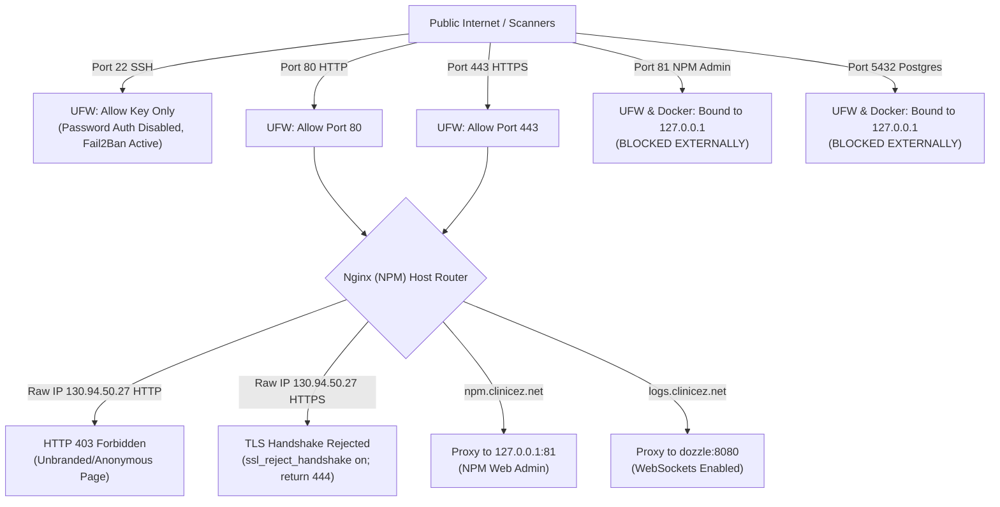

# Clinic EZ Production VPS Operations & Architecture Expert

This skill serves as the **exclusive** reference and operational playbook for managing, securing, and maintaining the **Clinic EZ Production VPS** (`130.94.50.27`). It codifies the architecture, configuration standards, hardening rules, and emergency recovery runbooks implemented across the production host system.

---

## 1. System Topology & Baseline Specifications

| Resource | Specification | Configuration & Purpose |
|---|---|---|
| **Public IPv4** | `130.94.50.27` | Direct origin IP (firewalled, Cloudflare-proxied endpoints). |
| **Compute** | 1 vCPU (Intel Xeon @ 2.0GHz) | Budget-conscious, lightweight container workloads. |
| **Physical RAM** | 1.9 GiB (2 GB budget) | Tuned buffers (`shared_buffers = 256MB`, low swappiness). |
| **Swap Storage** | 3.8 GiB (`/swap.img`) | Active swap buffer to prevent OOM killer on spike loads. |
| **Primary OS Drive** | `/dev/vda2` (50 GB SSD) | Host OS only (Ubuntu 24.04 LTS), ephemeral system logs. |
| **Stateful Data Volume** | `/dev/vdb` (10 GB Block) | **100% Portable storage**, persistent mount `/opt/clinicez/data`. |
| **SSH Access** | `root@130.94.50.27:22` | Key-based authentication only (`wave.cantery.ambray@gmail.com`). |

---

## 2. 100% Portable Storage Architecture (`/dev/vdb`)

All databases, proxy configurations, SSL certificates, log settings, and backup archives reside exclusively on the secondary block device (`/dev/vdb`), mounted to `/opt/clinicez/data` via UUID in `/etc/fstab`.

```text
/opt/clinicez/data/               <─── [Attached 10GB Block Volume: /dev/vdb]
├── compose/
│   ├── docker-compose.yml       # Production Compose definition (NPM, Postgres, Dozzle)
│   └── .env                     # Production database secrets & credentials (mode 600)
├── dozzle/                      # Dozzle persistent user preferences & settings (/data)
├── npm/
│   ├── data/                    # Nginx Proxy Manager SQLite database & host configs
│   └── letsencrypt/             # Let's Encrypt certificates & private keys
├── postgres/
│   ├── data/                    # PostgreSQL 17 relational cluster (all 8 databases)
│   └── conf/postgresql.conf     # Tuned database performance configuration
├── backups/                     # Daily gzipped database dumps (mode 600, 14-day retention)
└── scripts/
    ├── init-databases.sh        # PostgreSQL bootstrap with pgvector extensions
    └── backup-databases.sh      # Automated backup loop with gzip & retention pruning
```

### Portability Guarantees:
- **Disaster Rebuild**: The primary host OS (`/dev/vda`) can be formatted or reinstalled cleanly without losing any databases, proxy records, or SSL certificates.
- **Node Migration / Resizing**: To migrate to a larger VPS, simply detach `/dev/vdb`, attach it to the new server, mount it to `/opt/clinicez/data`, and run `docker compose up -d`.

---

## 3. Host Hardening & Security Policies



### 3.1. SSH Hardening
- Root login permitted strictly with authorized SSH key (`~/.ssh/authorized_keys`).
- Password authentication disabled: `PasswordAuthentication no`.
- Fail2Ban enabled with `[sshd]` jail: bans IP addresses after 3 failed attempts for 1 hour.

### 3.2. Port Exposure Rules (UFW)
- **Open Public Ports**:
  - `22/tcp` (SSH)
  - `80/tcp` (HTTP for Let's Encrypt challenges & Cloudflare proxy)
  - `443/tcp` (HTTPS for Cloudflare-proxied SSL traffic)
- **Closed / Localhost-Only Ports**:
  - `81/tcp` (NPM Admin Console): Bound strictly to `127.0.0.1:81:81` in `docker-compose.yml` and deleted from UFW.
  - `5432/tcp` (PostgreSQL): Bound strictly to `127.0.0.1:5432:5432` in `docker-compose.yml` and shielded from the internet.

### 3.3. Unbranded Direct IP Restriction
Direct IP access (`http://130.94.50.27` or `https://130.94.50.27`) is restricted to prevent reconnaissance:
- **HTTP Port 80**: Default server block in `/opt/clinicez/data/npm/data/nginx/default_host/site.conf` responds with **`HTTP/1.1 403 Forbidden`** and an unbranded, anonymous HTML error page (*"Direct IP Access Prohibited - Connections must be routed through an authorized domain name"*).
- **HTTPS Port 443**: Nginx enforces **`ssl_reject_handshake on; return 444;`**. It instantly rejects TLS negotiation, preventing port scanners (e.g. Shodan, Censys) from extracting SSL certificate Common Names or Subject Alternative Names (SANs).

### 3.4. Kernel & Resource Limits
- `/etc/sysctl.d/99-clinicez-production.conf`:
  - `vm.swappiness = 20` (prevents unnecessary swap thrashing on SSD).
  - `vm.vfs_cache_pressure = 50` (preserves filesystem inode/dentry caches).
  - `net.core.somaxconn = 65535` & `net.ipv4.tcp_max_syn_backlog = 4096`.
  - `net.ipv4.tcp_tw_reuse = 1` & `net.ipv4.tcp_fin_timeout = 15`.
- Docker Daemon (`/etc/docker/daemon.json`): Global log rotation capped at `max-size: 20m` with `max-file: 5` and `live-restore: true`.
- Systemd Journald (`/etc/systemd/journald.conf.d/size-limit.conf`): Capped at `SystemMaxUse=200M`.

### 3.5. Proportional Dynamic Resource Allocation (1 vCPU / 2GB RAM Standard)
To maximize throughput on a single vCPU (1.9 GiB RAM budget) while guaranteeing stability:
- **Work-Conserving Dynamic Scheduling (`cpu_shares`)**: Hard CPU throttling (`cpus: 0.2`) wastes up to 80% of the single core when few services are running. By using Linux CFS **`cpu_shares`**, any active service bursts to **100% of the vCPU** when other containers are idle. When multiple services compete, CPU cycles are divided strictly according to relative share weights.
- **Ceiling Quotas (`limits.cpus: "0.95"`)**: Prevents runaway threads or infinite loops from starving host SSH, UFW, or the Linux kernel.
- **Soft Memory Reservation (`reservations.memory`)**: Guaranteed baseline RAM. The kernel allows containers to burst into available physical RAM when others are idle.
- **Hard Memory Limit (`limits.memory`)**: Hard circuit-breaker ceiling protecting the host from kernel OOM panic.
- **.NET 10 Low-Memory Tuning**:
  - `DOTNET_gcServer=0`: Enforces Workstation GC, cutting per-container idle memory overhead by ~50%.
  - `DOTNET_GCHeapHardLimitPercent=75`: Instructs the .NET runtime to trigger proactive garbage collection before reaching the container's hard limit, preventing OOMKills.

#### Standard Production Resource Matrix:
| Service / Container | `cpu_shares` | Reserved CPU | Max CPU | Soft RAM (`reservations`) | Hard RAM (`limits`) | Role & Priority |
|---|---|---|---|---|---|---|
| **`postgres`** | 1536 | `0.20` | `0.95` | `256M` | `650M` | Primary database cluster (all 8 databases) |
| **`clinic-api`** | 1536 | `0.20` | `0.95` | `160M` | `450M` | Core clinical EHR, charting & Hangfire |
| **`portal-api`** | 1024 | `0.15` | `0.95` | `140M` | `400M` | Multi-tenant control plane, subscriptions |
| **`patient-api`** | 1024 | `0.15` | `0.95` | `140M` | `400M` | Patient portal, records & Clerk auth |
| **`interop-hub`** | 1024 | `0.15` | `0.95` | `120M` | `350M` | Message exchange & ECDSA verification |
| **`billing-api`** | 768 | `0.10` | `0.95` | `100M` | `300M` | Cashiering & invoices |
| **`laboratory-api`** | 768 | `0.10` | `0.95` | `90M` | `280M` | Specimen tracking & lab results |
| **`pharmacy-api`** | 768 | `0.10` | `0.95` | `90M` | `280M` | Dispensary & UPSC verification |
| **`organization-api`**| 512 | `0.05` | `0.95` | `80M` | `250M` | Multi-facility directories |
| **`philhealth-proxy`**| 512 | `0.05` | `0.95` | `60M` | `200M` | Outbound PhilHealth pass-through proxy |
| **`npm`** | 512 | `0.10` | `0.95` | `80M` | `250M` | Edge reverse proxy & SSL termination |
| **`dozzle`** | 128 | `0.02` | `0.30` | `15M` | `64M` | Real-time log viewer |


---

## 4. PostgreSQL 17 & `pgvector` Architecture

- **Container Image**: `pgvector/pgvector:pg17`
- **Vector Extension Version**: `0.8.7`
- **Network**: Isolated on internal Docker bridge `data-network`.

### 4.1. Databases Pre-Created with `pgvector`
All 8 Clinic EZ production databases have `pgvector` pre-installed. Additionally, `template1` has `vector` enabled so any new database created in the future automatically inherits vector support:

1. `CLINICEZ-PORTAL_DB`
2. `CLINICEZ-CLINIC_DB`
3. `CLINICEZ-LAB_DB`
4. `CLINICEZ-PHARMACY_DB`
5. `CLINICEZ-BILLING_DB`
6. `CLINICEZ-ORG_DB`
7. `CLINICEZ-PATIENT_DB`
8. `CLINICEZ-INTEROP_DB`

### 4.2. Memory Tuning (`postgresql.conf`)
Located at `/opt/clinicez/data/postgres/conf/postgresql.conf`:
- `shared_buffers = 256MB`
- `effective_cache_size = 768MB`
- `work_mem = 4MB`
- `maintenance_work_mem = 64MB`
- `max_connections = 60`
- `checkpoint_completion_target = 0.9`

### 4.3. Standard Connection String Format
For application microservices running on the VPS Docker network (`data-network`):
```text
Host=postgres;Port=5432;Database=CLINICEZ-CLINIC_DB;Username=db_admin_node;Password==5XQ*YuioBmjr45I3fOYrQvx;
```
> [!IMPORTANT]
> **Strict Environment Isolation**: Production credentials (e.g. database password `=5XQ*YuioBmjr45I3fOYrQvx` on `130.94.50.27`) MUST never overlap with Development credentials (`t-G9x#mK5!pQ2vW8*zY;` on `38.54.16.240`). All secrets, ECDSA P-256 keys, JWT keys, and client secrets are maintained independently in `configuration.prod.txt` and GitHub Environment `Production`.


---

## 5. Live Production Endpoints & Proxy Routing

| Public Hostname | Internal Target | TLS/SSL Mode | Purpose |
|---|---|---|---|
| **`https://npm.clinicez.net`** | `http://127.0.0.1:81` | Cloudflare Edge + Origin SSL | Nginx Proxy Manager graphical admin UI |
| **`https://logs.clinicez.net`** | `http://dozzle:8080` | Cloudflare Edge + Origin SSL | Dozzle real-time container log viewer (WebSockets enabled) |

---

## 6. Automated Backup & Disaster Recovery

### 6.1. Backup Automation
- **Script**: `/opt/clinicez/data/scripts/backup-databases.sh`
- **Cron Definition**: `/etc/cron.d/clinicez-backup`
- **Schedule**: Every night at **02:00 UTC**
- **Format**: Individual gzipped SQL dumps (`.sql.gz`) per database with permissions set to `0600`.
- **Retention**: Automatically purges dumps older than 14 days.

### 6.2. Manual Backup Trigger
To force an immediate backup of all 8 databases:
```bash
ssh -i ~/.ssh/id_ed25519 root@130.94.50.27 "/opt/clinicez/data/scripts/backup-databases.sh"
```

### 6.3. Restore Runbook
To restore a database (e.g. `CLINICEZ-CLINIC_DB`) from a backup archive:
```bash
ssh -i ~/.ssh/id_ed25519 root@130.94.50.27
cd /opt/clinicez/data/backups

# Find the desired backup file
LATEST_BACKUP=$(ls -t CLINICEZ-CLINIC_DB_*.sql.gz | head -n 1)

# Decompress and stream into Postgres
gunzip -c "$LATEST_BACKUP" | docker exec -i postgres psql -U db_admin_node -d CLINICEZ-CLINIC_DB
```

---

## 7. Common Operational Workflows

### 7.1. Check Cluster Health & Container Status
```bash
ssh -i ~/.ssh/id_ed25519 root@130.94.50.27 "docker ps --format 'table {{.Names}}\t{{.Status}}\t{{.Ports}}'"
```

### 7.2. Inspect Memory & Disk Utilization
```bash
ssh -i ~/.ssh/id_ed25519 root@130.94.50.27 "free -h; echo '---'; df -h /opt/clinicez/data"
```

### 7.3. Reload Nginx Without Downtime
```bash
ssh -i ~/.ssh/id_ed25519 root@130.94.50.27 "docker exec npm nginx -t && docker exec npm nginx -s reload"
```

### 7.4. Restart Compose Services
```bash
ssh -i ~/.ssh/id_ed25519 root@130.94.50.27 "cd /opt/clinicez/data/compose && docker compose up -d"
```

---

## 8. Critical Rules & Gotchas

> [!IMPORTANT]
> **Preserve `/opt/clinicez/data` Path**: Never place persistent production data on `/root`, `/var/lib`, or the root `/dev/vda2` drive. All stateful assets must live within `/opt/clinicez/data` to preserve the 100% portable storage guarantee.

> [!WARNING]
> **Bash & `.env` Quoting**: Passwords containing characters like `#` (e.g., `t-G9x#mK5!pQ2vW8*zY;`) will be truncated as bash/docker comments if unquoted. Always wrap credentials in double quotes `""` in `.env` files and shell scripts.

> [!CAUTION]
> **PostgreSQL Configuration Quoting**: String settings in `postgresql.conf` (such as `listen_addresses`, `log_line_prefix`, `timezone`) must use single quotes (`'...'`), **never** double quotes (`"..."`), or the server will fail to start.

> [!NOTE]
> **Dozzle Role**: Dozzle is an ultra-lightweight real-time **log viewer** (`~15MB` RAM footprint), not a metric/telemetry agent. It mounts `/var/run/docker.sock:ro` and `/opt/clinicez/data/dozzle:/data`.
