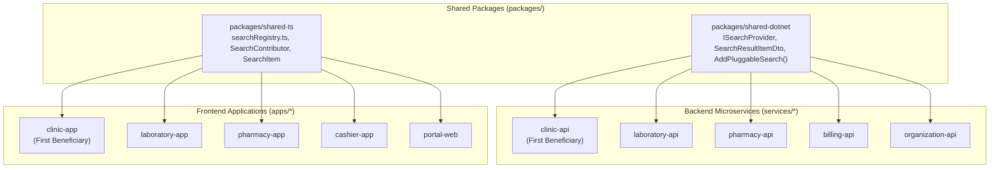

# ClinicEZ Universal Search Provider Expert Skill

The ClinicEZ Pluggable Search Provider Framework is the **platform-wide architectural standard** for unified, zero-touch search. While **Clinic Workspace (`clinic-api` & `apps/clinic-app`)** is the initial implementer and first beneficiary, this framework is designed to power the search experience across **all ClinicEZ services and client workstations**:

| Workstation / App | Backend Service | Primary Searchable Entities |
|---|---|---|
| **Clinic Workspace (`clinic-app`)** | `clinic-api` | Patients, Consultations, Appointments, Settings, Rooms, Services, Queue, Lab Orders |
| **Laboratory Workspace (`laboratory-app`)** | `laboratory-api` | Lab Requisitions, Test Panels, Specimen Tubes, Equipment, Panic Value Logs |
| **Pharmacy Workspace (`pharmacy-app`)** | `pharmacy-api` | Prescriptions, Medication Inventory, Stock Lots, Expiry Batches, Dispense History |
| **Cashier / POS (`cashier-app`)** | `billing-api` | Invoices, Payments, Claims, Cash Drawers, Senior/PWD Discounts |
| **Organization Portal (`portal-web`)** | `organization-api` / `portal-api` | Facilities, Branches, Staff Accounts, Licenses, Subscriptions, Audit Logs |
| **Patient App (`patient-app`)** | `patient-api` | Health Records, Scheduled Visits, Doctor Profiles, Prescriptions, Test Results |

---

## 1. Architectural Core Principles



1. **Zero-Touch Extensibility (Open-Closed Principle)**:
   - A service's search controller and orchestrator never change when features are added or removed.
   - Any module adds search capability simply by creating a class implementing `ISearchProvider`.
2. **Seamless Decommissioning**:
   - Deleting or commenting out a feature folder automatically unregisters its search provider. No broken SQL joins or orphaned endpoints.
3. **Shared Contracts, Domain-Specific Execution**:
   - The contract (`ISearchProvider`) and registration extensions live in `packages/shared-dotnet`.
   - Each service executes its own queries within its transactional database schema using native EF Core or Dapper.
4. **Concurrent Execution (`Task.WhenAll`)**:
   - The search orchestrator executes all discovered, active providers in parallel. Latency is bound by the single slowest category, typically sub-100ms.
5. **Tenant Isolation & RBAC Enforced at Provider Level**:
   - Every provider enforces tenant boundaries (`TenantId`).
   - Providers declare `RequiredPermission`. Staff lacking permission never trigger that provider's database query.
6. **Unified High-Density Design Token Compliance**:
   - Frontend components consume `@clinicez/design-tokens` with consistent semantic urgency indicators (`routine`, `urgent`, `emergency`, `neutral`).

---

## 2. Shared Backend Standard (`packages/shared-dotnet`)

### Contract (`packages/shared-dotnet/Search/ISearchProvider.cs`)
```csharp
using System;
using System.Collections.Generic;
using System.Threading;
using System.Threading.Tasks;

namespace ClinicEz.Shared.Search;

public interface ISearchProvider
{
    /// <summary>Unique category key (e.g. "Patients", "LabRequisitions", "InventoryLots").</summary>
    string Category { get; }

    /// <summary>Display priority in the search palette (lower numbers render first).</summary>
    int Priority { get; }

    /// <summary>Permission required to execute and view this category (null = visible to all authenticated staff).</summary>
    string? RequiredPermission { get; }

    /// <summary>Executes the category query against tenant data.</summary>
    Task<IReadOnlyList<SearchResultItemDto>> SearchAsync(
        string query,
        Guid tenantId,
        int limit,
        CancellationToken ct);
}
```

### Shared DTOs (`packages/shared-dotnet/Search/SearchResultItemDto.cs`)
```csharp
namespace ClinicEz.Shared.Search;

public sealed record SearchResultItemDto(
    string Id,
    string Category,
    string Title,
    string Subtitle,
    string? BadgeText,
    string? BadgeVariant, // "routine", "urgent", "emergency", "neutral"
    string TargetRoute,   // Navigation route in the host app
    Dictionary<string, string>? RouteParams
);

public sealed record SearchResponseDto(
    IReadOnlyList<SearchResultItemDto> Items,
    int TotalCount
);
```

### Shared Registration Extension (`packages/shared-dotnet/Search/SearchServiceExtensions.cs`)
```csharp
using Microsoft.Extensions.DependencyInjection;

namespace ClinicEz.Shared.Search;

public static class SearchServiceExtensions
{
    /// <summary>
    /// Scans the target assembly and registers all ISearchProvider implementations as scoped services.
    /// </summary>
    public static IServiceCollection AddPluggableSearch<TAssemblyMarker>(this IServiceCollection services)
    {
        services.Scan(scan => scan
            .FromAssemblyOf<TAssemblyMarker>()
            .AddClasses(classes => classes.AssignableTo<ISearchProvider>())
            .AsImplementedInterfaces()
            .WithScopedLifetime());

        return services;
    }
}
```

---

## 3. Service Implementation (Example: Any Service)

In any backend service (`services/clinic-api`, `services/laboratory-api`, `services/pharmacy-api`, etc.):

1. **Register search in `Program.cs` / `DependencyInjection.cs`**:
   ```csharp
   services.AddPluggableSearch<ApplicationMarker>();
   ```
2. **Add the Generic Search Controller (`Controllers/SearchController.cs`)**:
   ```csharp
   [ApiController]
   [Route("api/v1/search")]
   public sealed class SearchController : ControllerBase
   {
       private readonly ISender _sender;
       public SearchController(ISender sender) => _sender = sender;

       [HttpGet]
       public async Task<ActionResult<ApiResponse<SearchResponseDto>>> Search(
           [FromQuery] string? q,
           [FromQuery] string? category,
           [FromQuery] int limit = 20,
           CancellationToken ct = default)
       {
           if (string.IsNullOrWhiteSpace(q))
               return Ok(ApiResponse<SearchResponseDto>.Success(new SearchResponseDto([], 0)));

           var result = await _sender.Send(new GenericSearchQuery(q, category, limit), ct);
           return Ok(ApiResponse<SearchResponseDto>.Success(result));
       }
   }
   ```
3. **Feature Provider (e.g. `Features/Inventory/Search/InventoryLotSearchProvider.cs`)**:
   ```csharp
   public sealed class InventoryLotSearchProvider : ISearchProvider
   {
       private readonly IPharmacyDbContext _db;
       public string Category => "Inventory";
       public int Priority => 10;
       public string? RequiredPermission => "Pharmacy.InventoryRead";

       public InventoryLotSearchProvider(IPharmacyDbContext db) => _db = db;

       public async Task<IReadOnlyList<SearchResultItemDto>> SearchAsync(
           string query, Guid tenantId, int limit, CancellationToken ct)
       {
           return await _db.MedicationLots
               .AsNoTracking()
               .Where(l => l.TenantId == tenantId && (l.GenericName.Contains(query) || l.LotNumber.Contains(query)))
               .Take(limit)
               .Select(l => new SearchResultItemDto(
                   l.Id.ToString(),
                   Category,
                   l.GenericName,
                   $"Lot #{l.LotNumber} • Exp: {l.ExpiryDate:MM/yyyy} • Qty: {l.RemainingCount}",
                   l.RemainingCount < 10 ? "Low Stock" : "In Stock",
                   l.RemainingCount < 10 ? "urgent" : "routine",
                   "InventoryDetail",
                   new Dictionary<string, string> { { "lotId", l.Id.ToString() } }
               ))
               .ToListAsync(ct);
       }
   }
   ```

---

## 4. Shared Frontend Standard (`packages/shared-ts`)

### Shared Registry (`packages/shared-ts/search/searchRegistry.ts`)
```typescript
export interface SearchItem {
  id: string;
  category: string;
  title: string;
  subtitle: string;
  badgeText?: string;
  badgeVariant?: 'routine' | 'urgent' | 'emergency' | 'neutral';
  targetRoute: string;
  routeParams?: Record<string, string>;
  onSelect?: () => void;
}

export interface SearchContributor {
  id: string;
  category: string;
  categoryLabel: string;
  priority?: number;
  requiredPermission?: string;
  search: (query: string) => Promise<SearchItem[]> | SearchItem[];
}

class UniversalSearchRegistry {
  private contributors: Map<string, SearchContributor> = new Map();

  register(contributor: SearchContributor): () => void {
    this.contributors.set(contributor.id, contributor);
    return () => this.contributors.delete(contributor.id);
  }

  getContributors(): SearchContributor[] {
    return Array.from(this.contributors.values()).sort(
      (a, b) => (a.priority ?? 50) - (b.priority ?? 50)
    );
  }
}

export const universalSearchRegistry = new UniversalSearchRegistry();
```

---

## 5. Workstation UI Component Pattern (`GlobalSearchModal.tsx`)

Every workstation client (`clinic-app`, `laboratory-app`, etc.) mounts the standard command palette:
- **Trigger**: Clickable search bar in header + `Cmd+K` / `Ctrl+K` / `/` shortcut.
- **Dynamic Categories**: Populated from active contributors registered in `universalSearchRegistry`.
- **Keyboard Control**: Up/Down arrow selection, `Enter` to navigate, `Esc` to close.
- **Empty State**: Recent searches and Quick Actions autodiscovered from route manifests.
- **Styling**: Strict adherence to `@clinicez/design-tokens`.

---

## 6. Verification & Extension Checklist (Any Service)

When adding or removing features in any ClinicEZ service:
- [ ] Provider implements `ISearchProvider` from `ClinicEz.Shared.Search`.
- [ ] Database query enforces `tenantId` parameter filtering.
- [ ] Provider declares `RequiredPermission` or sets it to `null`.
- [ ] Zero changes made to `SearchController.cs` or query orchestrator.
- [ ] In frontend, contributor registers with `universalSearchRegistry` and maps `targetRoute`.
- [ ] Unit tests verify assembly scanning auto-discovers the new provider.
