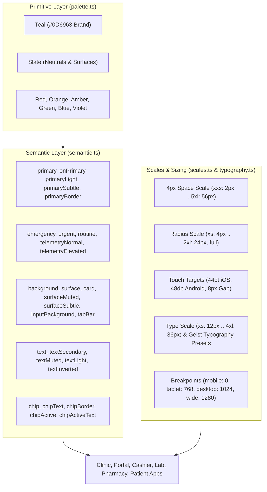
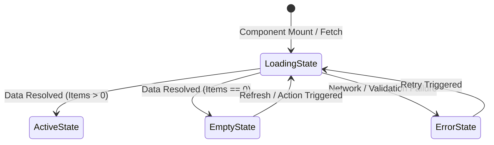

# ClinicEZ UI/UX Expert Skill

This skill defines the UI/UX design foundation, interaction principles, visual hierarchy, mobile-first touch ergonomics, and component guidelines for all ClinicEZ frontend applications (web workstations, administrative portals, and mobile client apps).

> [!IMPORTANT]
> **Design Token Boundary Mandate**:
> This skill is strictly bounded by the core design tokens of `@clinicez/design-tokens`—not by any specific screen design, temporary wireframe, or one-off component.
> Every layout, surface, typographic element, interactive control, animation delta, and clinical status across any screen in the ClinicEZ ecosystem must be derived directly from the design token system.

---

## 1. Design Token System Architecture

The design token system provides a single source of truth across all platforms (web workstations, desktop rails, iOS, and Android mobile applications):



### Strict Token Consumption Rules
1. **Zero Raw Hex Colors**: Components and screens must **NEVER** use raw hex codes (e.g. `#0D6963`, `#F8FAFC`, `#000000`). All colors must be read from semantic tokens (`colors.primary`, `colors.surface`, etc.).
2. **Zero Raw Numeric Font Sizes in StyleSheets**: All typography must use `<ThemedText variant="...">` or token styles (`theme.typography.*`, `fontSizes.*`). Nothing in a clinical UI may be styled below 12px (`fontSizeScale.xs`).
3. **Zero Off-Grid Spacing**: Layout paddings, margins, and gaps must strictly consume `spaceScale` (`spacing.xs`, `spacing.sm`, `spacing.md`, etc.).
4. **Dual-Theme Parity**: `darkColors` is strictly typed against `lightColors`. Every color token exists in both schemes with guaranteed $\ge 4.5:1$ WCAG contrast.

---

## 2. Semantic Color System & Clinical Visual Encoding

Healthcare interfaces require unambiguous visual hierarchy to ensure safety and minimize cognitive fatigue under high stress.

### Clinical Urgency Encoding

Never rely solely on color for urgency—always combine semantic urgency colors with clear typographic badges (`STAT`, `Urgent`, `Routine`, `Optimal`, `Elevated`):

| Clinical Level | Visual Encoding | Semantic Color Tokens | Intended Clinical Context |
|---|---|---|---|
| **Emergency (STAT)** | Red Badge + Text + Border | `emergencyBg`, `emergencyText`, `emergencyBorder` | Triage bump, life-threatening vitals, immediate encounter required |
| **Urgent** | Orange Badge + Text | `urgentBg`, `urgentText`, `urgentBorder` | Priority queue, overdue medication, expedited encounter |
| **Routine** | Teal Badge + Text | `routineBg`, `routineText`, `routineBorder` | Standard consultation, regular appointment, normal queue item |
| **Telemetry Normal** | Teal Badge + Soft Tint | `telemetryNormalBg`, `telemetryNormalText` | Vital signs within reference ranges (HR 60–100, BP <120/80) |
| **Telemetry Elevated** | Amber Badge + Accent | `telemetryElevatedBg`, `telemetryElevatedText` | Pre-hypertensive, elevated fasting blood glucose, follow-up needed |

### Interactive Surfaces & Chips
- **Primary Actions**: `primary` (#0D6963 in light, #34C3A6 in dark) paired with `onPrimary`.
- **Secondary Surfaces**: `surface` (card body), `surfaceMuted` (headers), `surfaceSubtle` (interactive icon circles).
- **Filter Chips & Category Pills**:
  - Inactive: `chip` background, `chipText`, `chipBorder`.
  - Active / Selected: `chipActive` background, `chipActiveText`.

---

## 3. Spatial, Typography & Dimension Scales

Every UI layout is constructed from discrete mathematical scales:

### Spacing Scale (`spaceScale` — 4px Baseline Grid)
`xxs: 2`, `xs: 4`, `sm: 8`, `md: 12`, `lg: 16`, `xl: 20`, `2xl: 24`, `3xl: 32`, `4xl: 40`, `5xl: 56`.

### Corner Radii Scale (`radiusScale`)
- `xs: 4`: Tags, subtle badges.
- `sm: 6`: Compact action buttons, tooltips.
- `md: 10`: Standard card radius, form inputs (matches Portal `--radius`).
- `lg: 14`: Large content cards, Bento grid tiles.
- `xl: 18`: Modal dialogs, hero health pass cards.
- `2xl: 24`: Prominent sheet wrappers.
- `full: 9999`: Pills, avatar circles, filter chips.

### Typography Scale & Presets (`typography.ts`)
Rendered exclusively using the **Geist** (sans) and **Geist Mono** (tabular/numeric) typefaces:
- `display` (36px / 700): Hero statistics, KPI counters.
- `h1` (28px / 700): Primary page titles.
- `h2` (22px / 600): Section headers, card group titles.
- `title` (18px / 600): Subheadings, card titles.
- `h3` / `bodyLarge` (16px / 600 or 400): Prominent body copy, primary button text.
- `body` / `bodyBold` (14px / 400 or 600): Standard clinical table text, form inputs, list items.
- `small` / `smallBold` (13px / 400 or 600): Secondary descriptions, metadata lines.
- `caption` / `captionBold` (12px / 400 or 600): Timestamps, field labels, status pills.
- `badge` (12px / 600, +0.2 letterSpacing): Clinical triage tags (`STAT`, `Urgent`, `Confirmed`).
- `code` (12px / 500, GeistMono): Patient IDs, access codes, prescription dosage strings.

---

## 4. Mobile Touch Ergonomics Bounded by Tokens (from `/mobile-design`)

> [!NOTE]
> Mobile users operate with imprecise thumbs on dynamic, distracting environments. Design decisions must be grounded in physical touch constraints, not desktop assumptions.

1. **Touch Targets (Fitts' Law)**:
   - **iOS Minimum**: `sizes.touchTarget` = **44pt × 44pt**.
   - **Android Minimum**: `sizes.touchTargetAndroid` = **48dp × 48dp**.
   - **Spacing Guardrail**: `sizes.touchTargetGap` = **8px** minimum between adjacent interactive elements to prevent mis-taps.
2. **Thumb Zone Hierarchy**:
   - **Natural Thumb Arc (Bottom Viewport)**: Primary calls-to-action ("Book Appointment", "Log Now", "Check In"), bottom tab navigation, bottom sheet actions.
   - **Neutral Reach Zone (Center Viewport)**: Content cards, Bento telemetry grids, scrollable list items.
   - **Stretch Zone (Top Viewport)**: Navigation back buttons, avatar profiles, search input fields.
3. **60fps GPU-Accelerated Micro-Interactions**:
   - **Never animate layout geometry** (`width`, `height`, `margin`, `padding`, `top`, `bottom`)—these force CPU layout reflows and cause jank.
   - **Always animate GPU properties**: `transform` (e.g. `translateY`, `scale`) and `opacity`.
   - **Header Scroll Micro-Interaction**:
     - At scroll offset $y = 0$, header title and subtitle are hidden (`opacity: 0`, `translateY: sizes.headerScrollOffsetTranslate` = 6px).
     - Smoothly interpolate across $y \in [0, \text{sizes.headerScrollThreshold}]$ (0 to 48px) to reach full visibility (`opacity: 1`, `translateY: 0`).
4. **List Performance**:
   - Virtualized lists (`FlatList` / `FlashList`) for open-ended clinical collections.
   - Memoize list items (`React.memo` + `useCallback`) to preserve 60fps scrolling.

---

## 5. Universal 4-State Component Lifecycle

Every screen, widget, card, and data container in ClinicEZ must explicitly handle all 4 states using design tokens:



1. **Loading State (Skeleton Loaders)**:
   - Render layout-matched skeleton boxes using `colors.skeletonBase` and `colors.skeletonHighlight` with subtle pulse animation.
   - Never use full-screen blank spinners that cause sudden layout shifts.
2. **Empty State (Actionable Guidance)**:
   - Never display a blank card, raw empty table, or dead-end screen.
   - Always render an empty container using `colors.surface` or `colors.surfaceMuted`, an explanatory description in `colors.textMuted`, and an actionable primary button.
3. **Error State (Clinical Safety & Recovery)**:
   - Present human-readable, non-technical error explanations using `colors.emergency` / `colors.emergencyBg` / `colors.emergencyText`.
   - Always include an immediate recovery path (e.g. "Retry", "Check Connection", or "Call Clinic").
4. **Active State (Populated Presentation)**:
   - Group data into clear visual sections using card containers (`colors.surface`, `radii.lg`, `radii.xl`, `shadows.sm`).
   - Use high-contrast headings (`colors.text`) and secondary descriptors (`colors.textSecondary`).

---

## 6. Cross-Platform Parity & Consumption Patterns

### Responsive Breakpoints (`scales.ts`)
- `mobile`: 0–767px (single-column touch layout).
- `tablet`: 768–1023px (compact multi-column grid).
- `desktop`: 1024–1279px (workstation 2-column triage rail layout).
- `wide`: $\ge 1280$px (expanded clinical dashboard).

### Web Consumption Pattern (Next.js / Tailwind CSS)
Semantic tokens are mapped to CSS custom properties. Consume them via Tailwind classes:

```tsx
export function ClinicalCard({ title, children }: { title: string; children: React.ReactNode }) {
  return (
    <div className="bg-surface border border-border rounded-md p-4 shadow-sm">
      <h3 className="text-base font-semibold text-text mb-2">{title}</h3>
      <div className="text-sm text-textSecondary">{children}</div>
    </div>
  );
}
```

### Mobile Consumption Pattern (Expo / React Native)
Semantic tokens are provided via typed `useAppTheme()` hook:

```tsx
import React from 'react';
import { View, StyleSheet, TouchableOpacity } from 'react-native';
import ThemedText from '../ui/ThemedText';
import { useAppTheme } from '../../contexts/ThemeContext';

export function ActionTile({ label, onPress }: { label: string; onPress: () => void }) {
  const { colors, spacing, radii, sizes } = useAppTheme();

  return (
    <TouchableOpacity
      onPress={onPress}
      activeOpacity={0.8}
      style={[
        styles.tile,
        {
          backgroundColor: colors.surface,
          borderColor: colors.border,
          borderRadius: radii.lg,
          padding: spacing.md,
          minHeight: sizes.touchTarget,
        },
      ]}
    >
      <ThemedText variant="bodyBold" color="text">{label}</ThemedText>
    </TouchableOpacity>
  );
}

const styles = StyleSheet.create({
  tile: {
    borderWidth: 1,
    justifyContent: 'center',
    alignItems: 'center',
  },
});
```

---

## 7. Zero Mock Data Mandate

A clinical interface must never show misleading synthetic data in production or live tests:
- **Never Hardcode Provider Fallbacks**: Do not inject placeholder doctor names (`'Dr. Evelyn Reed'`, `'Dr. David Chen'`). Use neutral descriptive copy (`'Healthcare Provider'`, `'Network Clinic'`) or an actionable empty state.
- **Offline Resilience**: Mirror live backend records to local SQLite tables (`vitalSigns`, `patientMedications`, `clinics`). During network failures, resolve cached rows gracefully without displaying broken states.

---

## 8. UI/UX Quality & Token Audit Checklist

Before considering any UI implementation complete, run this audit checklist:

1. **Strict Token Guard**: Run `bun apps/patient-app/scripts/check-tokens.mjs --strict`. Must report **0 violations in 0 files**.
2. **Contrast Verification**: Run `bun test packages/design-tokens/src/tokens.test.ts`. All text/background combinations must pass $\ge 4.5:1$ WCAG ratio across light and dark modes.
3. **Touch Targets**: All mobile buttons, chips, and tappable rows have $\ge 44\text{pt}$ (iOS) or $\ge 48\text{dp}$ (Android) hit area with $\ge 8\text{px}$ gaps.
4. **4-State Completeness**: Skeleton loading, actionable empty state, error state with retry, and active populated state are all implemented.
5. **GPU Animation Safety**: Animated elements only interpolate `opacity` and `transform`. Layout properties (`height`, `margin`, `padding`) are strictly static.
6. **Cross-Platform Verification**: Layout functions correctly on mobile touch screens (<768px) and scales to desktop workstation rails ($\ge 1024\text{px}$).
