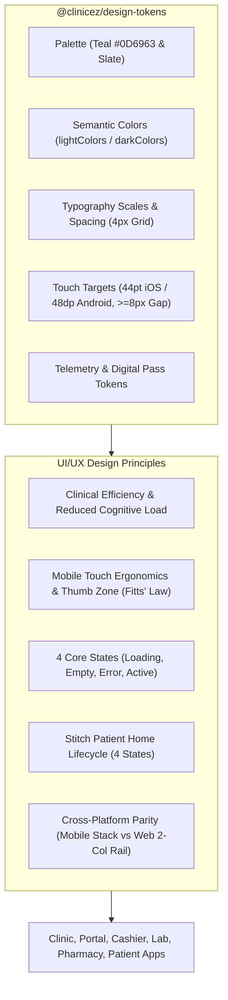
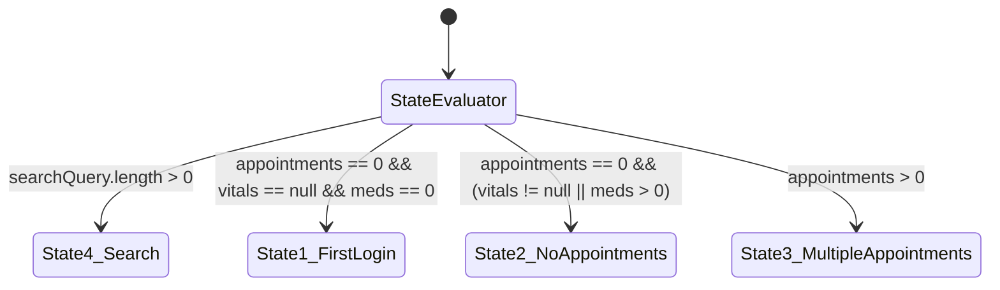

# ClinicEZ UI/UX Expert Skill

This skill defines the UI/UX design foundation, interaction principles, visual hierarchy, mobile-first touch ergonomics, and component guidelines for all ClinicEZ frontend applications (web workstations, administrative portals, and mobile client apps). Its foundation is built directly upon the `@clinicez/design-tokens` design system, aligned with the **`/mobile-design`** philosophy: *Touch-first, battery-conscious, platform-respectful, offline-capable*.

---

## 1. UI/UX Core Foundations



---

## 2. Clinical UX Principles & Cognitive Load

Healthcare environments require fast, unambiguous, error-resistant user interfaces for both clinicians and patients.

1. **High-Density Workstation Hierarchy vs Glanceable Mobile Views**:
   - **Clinician Workstations (`clinic-app`, `portal-web`)**: High density, 2-column triage rails, keyboard accelerators, instant scanability for encounter queues.
   - **Patient Client Apps (`patient-app`)**: Low cognitive load, single primary decision per screen, high contrast, glanceable telemetry cards (Bento grid), single-tap adherence logging.
2. **Clinical Urgency Visual Encoding**:
   - Never rely solely on color for urgency—always combine semantic urgency colors with text badges (`STAT`, `Urgent`, `Routine`).

| Urgency Level | Visual Encoding | Semantic Token Mapping | UX Context |
|---|---|---|---|
| **Emergency (STAT)** | Red Badge + Border | `emergencyBg`, `emergencyText`, `emergencyBorder` | Requires immediate medical attention / triage bump |
| **Urgent** | Orange Badge + Text | `urgentBg`, `urgentText`, `urgentBorder` | Priority queue / expedited processing |
| **Routine** | Teal Badge + Text | `routineBg`, `routineText`, `routineBorder` | Standard consultation / queue item |
| **Telemetry Normal** | Teal Badge + Soft Tint | `telemetryNormalBg`, `telemetryNormalText` | Vitals in optimal reference range (HR 60-100, BP <120/80) |
| **Telemetry Elevated** | Amber Badge + Accent | `telemetryElevatedBg`, `telemetryElevatedText` | Pre-hypertensive / fasting glucose monitoring |

3. **Error Prevention & Defensive Form UX**:
   - Group related fields logically (Patient Identification -> Vitals -> Assessment).
   - Use inline validation as fields lose focus (`onBlur`), rather than waiting for full form submission.
   - Disable submit buttons while processing (`loading` state with spinner) to prevent duplicate submissions.

---

## 3. Mobile Touch Interaction Ergonomics (from `/mobile-design`)

> [!IMPORTANT]
> **Mobile is NOT a Small Desktop**:
> Mobile users operate with imprecise thumbs on dynamic, distracting environments. Always apply touch psychology and performance constraints.

1. **Fitts' Law & Touch Targets**:
   - Minimum touch target: **44pt × 44pt** on iOS (`sizes.touchTarget`), **48dp × 48dp** on Android (`sizes.touchTargetAndroid`).
   - Minimum spacing between interactive targets: **8–12px** (`sizes.touchTargetGap: 8`) to eliminate accidental neighbor taps.
2. **Thumb Zone Architecture**:
   - **Easy to Reach (Natural Thumb Arc)**: Primary CTAs ("Book Appointment", "Log Now", "Check In"), Bottom Navigation tabs, bottom sheet actions.
   - **OK to Reach (Center)**: Scrollable content cards, Vitals Bento grid, medication schedules.
   - **Hard to Reach (Top Stretch)**: Back button, profile avatar, non-critical settings.
3. **60fps GPU-Accelerated Micro-Interactions**:
   - Only animate `transform` and `opacity` properties using the GPU. Avoid animating layout properties (`height`, `margin`, `padding`, `top`, `bottom`) that trigger CPU reflows.
   - **Scroll-Animated Header Pattern**: Header title and subtitle are hidden at $y = 0$ (`opacity: 0`, `translateY: 6`), and smoothly interpolate across scroll offset `[0, 48]` (`sizes.headerScrollThreshold`) to full visibility (`opacity: 1`, `translateY: 0`).

---

## 4. Stitch 4-State Patient Home Screen Architecture

The patient app home screen dynamically resolves across 4 distinct states according to real patient clinical data without dummy mock fallbacks:



1. **State 1: First Login / Zero Data Home (`1cf209f95c7247fe8b5c2b7f9eacfc6b`)**:
   - Displays `WelcomeOnboardingCard` with a 3-step getting started checklist:
     1. Complete health profile
     2. Link health insurance & PhilHealth YAKAP benefits
     3. Find and bookmark primary clinic
   - Telemetry shows `--` placeholder dashes in `VitalsBentoGrid` alongside a prominent "Sync Apple Health or Log Manually" connect banner.
   - Appointments section displays a zero-data consultation prompt with "Book First Appointment".
   - Medications schedule displays an empty-state card with "+ Add Medication".

2. **State 2: No Appointments Variant (`39745062e8054cbc8c8fdd0df7bd7e9b`)**:
   - Active when 0 appointments are scheduled but the patient has active telemetry or medications.
   - Displays an empty consultation card with a primary "Book an Appointment" CTA and secondary "View Visit History" action.
   - Populates live telemetry in `VitalsBentoGrid` (Heart Rate, Blood Pressure, Fasting Glucose, Sleep Hours).
   - Displays today's scheduled doses with single-tap "Log Now" adherence tracking.

3. **State 3: Multiple Appointments Patient Home (`0ea4134bdcec496f87fc90ffa94fcea4`)**:
   - Features `HealthPassCard`: Digital linear gradient health pass with patient ID badge, blood group badge, NFC tap prompt, and trigger for `HealthPassQrModal`.
   - Renders horizontal snap carousel for upcoming consultations with doctor avatar, presence indicator, specialty, appointment badge (`Confirmed`, `Pending`), "Check In" button, and "Directions" button.

4. **State 4: Categorized Search Mode (`0a03c140a91843e59b4be878d9d3b196`)**:
   - Triggered when `searchQuery.trim().length > 0`.
   - Multi-category search filter chips (`All`, `Doctors`, `Clinics`, `Services`, `Available Today`).
   - Categorized search results:
     - **Doctors & Specialists**: Doctor card with portrait, rating, review count, location, and "Book Visit".
     - **Clinics & Care Centers**: Facility card with address, open/close status, distance, and "View Clinic".
     - **Specialized Care Packages**: Service card with coverage tags, duration, and "Schedule".

---

## 5. UI Component Architecture & Design Token Consumption

> [!IMPORTANT]
> **Strict UI Token Mandate**:
> Apps must **NEVER** use hardcoded hex values (`#0D6963`, `#F8FAFC`) or consume `palette.ts` raw values directly in component styles.
> All UI styling must consume semantic tokens from `@clinicez/design-tokens` (`semantic.ts`) and scales from `scales.ts`.

### Cross-Platform Layout Parity Pattern

```tsx
// Mobile Stack vs Desktop Workstation Rail
export function ResponsiveHomeLayout({ isDesktop, children, railContent }) {
  if (isDesktop) {
    return (
      <View style={styles.desktopRow}>
        <View style={styles.mainWorkstationCol}>{children}</View>
        <View style={styles.utilityRailCol}>{railContent}</View>
      </View>
    );
  }
  return <View style={styles.mobileCol}>{children}{railContent}</View>;
}
```

### Micro-Interaction: Scroll Animated Header Pattern

```tsx
import React from 'react';
import { Animated, StyleSheet } from 'react-native';
import { useAppTheme } from '../../contexts/ThemeContext';

export function HeaderScrollTitle({ scrollY }: { scrollY: Animated.Value }) {
  const { colors, typography, sizes } = useAppTheme();

  const opacity = scrollY.interpolate({
    inputRange: [0, sizes.headerScrollThreshold], // 0 to 48px
    outputRange: [0, 1],
    extrapolate: 'clamp',
  });

  const translateY = scrollY.interpolate({
    inputRange: [0, sizes.headerScrollThreshold], // 0 to 48px
    outputRange: [sizes.headerScrollOffsetTranslate, 0], // 6px to 0px
    extrapolate: 'clamp',
  });

  return (
    <Animated.View style={[styles.container, { opacity, transform: [{ translateY }] }]}>
      <Animated.Text style={[styles.title, { color: colors.text }]}>Clinic EZ</Animated.Text>
      <Animated.Text style={[styles.subtitle, { color: colors.textSecondary }]}>
        Open Health Network
      </Animated.Text>
    </Animated.View>
  );
}

const styles = StyleSheet.create({
  container: { justifyContent: 'center' },
  title: { fontSize: 16, fontWeight: '700' },
  subtitle: { fontSize: 12, fontWeight: '500' },
});
```

---

## 6. Zero Mock Data & Offline Resilience

1. **Zero Mock Fallbacks**:
   - Never fall back to hardcoded dummy doctor names (`'Dr. Evelyn Reed'`, `'Dr. David Chen'`).
   - If provider or clinic data is missing, display empty states or neutral fallback copy (`'Network Clinic'`, `'Healthcare Provider'`).
2. **Bidirectional SQLite Caching & SWR**:
   - All live remote data (vitals, medications, appointments, clinics) is mirrored locally to SQLite.
   - In offline mode or during network timeouts, SWR immediately resolves cached data from SQLite tables (`vitalSigns`, `patientMedications`, `clinics`) without crashing.

---

## 7. Technical Specifications & References

For exhaustive token tables, typography scales, dark mode mappings, and full component code patterns, refer to:

- [Design Tokens & UI/UX Component Reference](references/design_tokens_and_components.md)
- [Design Tokens Package Source](../../packages/design-tokens/src/index.ts)

---

## 8. UI/UX Audit & Quality Checklist

Before completing any UI screen or feature, perform this UI/UX audit:

1. **Token Compliance**: No raw hex codes or direct `palette.ts` imports in `.tsx` / `.jsx`. Run `bun apps/patient-app/scripts/check-tokens.mjs --strict`.
2. **Touch Target Size**: Minimum 44×44pt on iOS, 48×48dp on Android, with ≥8px spacing between neighbors.
3. **Visual Hierarchy**: Clear primary, secondary, and muted text contrast satisfying WCAG 4.5:1.
4. **4-State Completion**: Explicit Skeleton, Empty, Error, and Active states verified.
5. **Stitch State Accuracy**: Correct handling of First Login, No Appointments, Multiple Appointments, and Search Mode.
6. **Cross-Device Parity**: UI scales cleanly on desktop workstation (>=1024px), tablet (768px-1023px), and mobile (<768px).
7. **Token Automated Tests**: `bun test packages/design-tokens/src/tokens.test.ts` passes with 0 failures.
