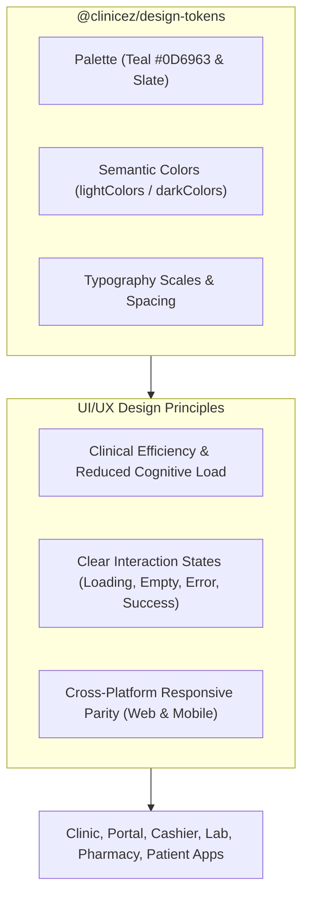

# ClinicEZ UI/UX Expert Skill

This skill defines the UI/UX design foundation, interaction principles, visual hierarchy, and component guidelines for all ClinicEZ frontend applications (web workstations, administrative portals, and mobile client apps). Its foundation is built directly upon the `@clinicez/design-tokens` design system.

---

## 1. UI/UX Core Foundations



---

## 2. Clinical UX Principles & Cognitive Load

Healthcare environments require fast, unambiguous, error-resistant user interfaces.

1. **High-Density Workstation Hierarchy**:
   - Primary actions must be obvious within 2 seconds of scanning a screen.
   - Use clear visual weight: Primary buttons (Teal `#0D6963`), Secondary outlines, Destructive/Emergency accents (Red).
2. **Clinical Urgency Visual Encoding**:
   - Never rely solely on color for urgency—always combine semantic urgency colors with text badges (`STAT`, `Urgent`, `Routine`).

| Urgency Level | Visual Encoding | Semantic Token Mapping | UX Context |
|---|---|---|---|
| **Emergency (STAT)** | Red Badge + Border | `emergencyBg`, `emergencyText`, `emergencyBorder` | Requires immediate medical attention / triage bump |
| **Urgent** | Orange Badge + Text | `urgentBg`, `urgentText`, `urgentBorder` | Priority queue / expedited processing |
| **Routine** | Teal Badge + Text | `routineBg`, `routineText`, `routineBorder` | Standard consultation / queue item |

3. **Error Prevention & Defensive Form UX**:
   - Group related fields logically (Patient Identification -> Vitals -> Assessment).
   - Use inline validation as fields lose focus (`onBlur`), rather than waiting for full form submission.
   - Disable submit buttons while processing (`loading` state with spinner) to prevent duplicate submissions.

---

## 3. Interaction Design & State Management

Every screen and widget must explicitly handle all 4 core UI/UX states:

1. **Loading State**:
   - Use Skeleton loaders (`skeletonBase` / `skeletonHighlight`) matching the exact layout of incoming content instead of full-page spinners.
2. **Empty State**:
   - Never show a blank card or empty table. Include a relevant icon, explanatory text, and a primary call-to-action button (e.g. *"No active encounters found. Create new encounter"*).
3. **Error State**:
   - Display actionable, human-readable error messages. Use `apiError.ts` and `showApiToast` for standardized toast feedback.
4. **Success / Active State**:
   - Provide immediate visual confirmation upon action completion (e.g. green success checkmark toast, subtle row highlight).

---

## 4. UI Component Architecture & Design Token Consumption

> [!IMPORTANT]
> **Strict UI Token Mandate**:
> Apps must **NEVER** use hardcoded hex values (`#0D6963`, `#F8FAFC`) or consume `palette.ts` raw values directly.
> All UI styling must consume semantic tokens from `@clinicez/design-tokens` (`semantic.ts`).

### Web Workstation Component Pattern (Next.js / Tailwind)

```tsx
import React from 'react';
import { Shell } from '@/components/Shell';
import { ShellCard } from '@/components/ShellCard';
import { showApiToast } from '@/lib/apiToast';

export function WorkstationQueueView() {
  return (
    <Shell title="Clinical Queue" subtitle="Active patient encounters for today">
      <div className="grid grid-cols-1 lg:grid-cols-3 gap-6">
        <ShellCard title="Emergency / STAT Queue">
          {/* Workstation high-density queue list */}
        </ShellCard>
      </div>
    </Shell>
  );
}
```

### Mobile App Component Pattern (Expo / React Native)

```tsx
import React from 'react';
import { View, Text, StyleSheet, TouchableOpacity } from 'react-native';
import { lightColors } from '@clinicez/design-tokens';

interface PrimaryButtonProps {
  label: string;
  onPress: () => void;
  loading?: boolean;
}

export const PrimaryButton: React.FC<PrimaryButtonProps> = ({ label, onPress, loading }) => {
  return (
    <TouchableOpacity
      style={[styles.button, loading && styles.disabled]}
      onPress={onPress}
      disabled={loading}
      activeOpacity={0.8}
    >
      <Text style={styles.buttonText}>{loading ? 'Processing...' : label}</Text>
    </TouchableOpacity>
  );
};

const styles = StyleSheet.create({
  button: {
    backgroundColor: lightColors.primary,
    paddingVertical: 12,
    paddingHorizontal: 20,
    borderRadius: 8,
    alignItems: 'center',
    justifyContent: 'center',
  },
  disabled: {
    opacity: 0.6,
  },
  buttonText: {
    color: lightColors.onPrimary,
    fontSize: 16,
    fontWeight: '600',
  },
});
```

---

## 5. Technical Specifications & References

For exhaustive token tables, typography scales, dark mode mappings, and full component code patterns, refer to:

- [Design Tokens & UI/UX Component Reference](file:///c:/Users/User/projects/nextstep/github/clinicez-arch2/.agents/skills/clinicez-ui-ux-expert/references/design_tokens_and_components.md)
- [Design Tokens Package Source](../../packages/design-tokens/src/index.ts)

---

## 6. UI/UX Audit & Quality Checklist

Before completing any UI screen or feature, perform this UI/UX audit:

1. **Token Compliance**: No raw hex codes or direct `palette.ts` imports in `.tsx` / `.jsx`.
2. **Visual Hierarchy**: Clear primary, secondary, and muted text contrast.
3. **4-State Completion**: Explicit Skeleton, Empty, Error, and Active states verified.
4. **Clinical Clarity**: Urgency levels properly mapped with semantic badges (`STAT`, `Urgent`, `Routine`).
5. **Cross-Device Parity**: UI scales cleanly on desktop workstation (>=1024px), tablet (768px-1023px), and mobile (<768px).
6. **Token Automated Tests**: `bun test packages/design-tokens/src/tokens.test.ts` passes with 0 failures.
