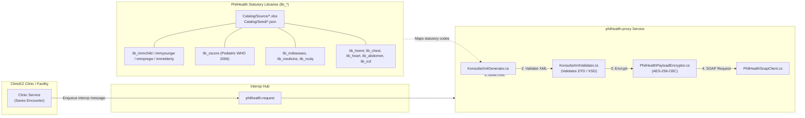

# PhilHealth Yakap (Konsulta) Integration Expert Skill

PhilHealth Yakap (Konsulta) integration provides automated electronic transmission of outpatient encounters, electronic Primary Care Benefit (ePCB) registrations, electronic Konsulta Availment Slips (eKAS), electronic Summary of Encounter Reports (eSER), digital prescriptions, diagnostic orders, masterlist synchronization, and strict mapping against **PhilHealth Statutory Catalogs and Libraries (`lib_*`)**.

This skill details schema specifications, statutory libraries (with source Excel `.xlsx` files and JSON `.json` seed tables), XML generation pipelines, validation protocols, AES encryption wrappers, SOAP client communication, and Interop Hub routing.

---

## Architecture & Data Flow

---

## Repository Locations for `lib_*.xlsx` & `lib_*.json`

PhilHealth statutory dictionaries are stored directly in the repository under the Clinic service infrastructure:

1. **Source Excel Files (`*.xlsx`)**:
   - Location: [`services/clinic-api/ClinicEz.Clinic.Infrastructure/PhilHealth/Catalog/Source/`](../../services/clinic-api/ClinicEz.Clinic.Infrastructure/PhilHealth/Catalog/Source)
   - Contains raw PhilHealth statutory spreadsheets: `lib_immchild.xlsx`, `lib_immyoungw.xlsx`, `lib_immpregw.xlsx`, `lib_immelderly.xlsx`, `lib_zscore.xlsx`, `lib_mdiseases.xlsx`, `lib_ncdq.xlsx`, `lib_icd.xlsx`, `lib_medicine.xlsx`, `lib_heent.xlsx`, `lib_chest.xlsx`, `lib_heart.xlsx`, `lib_abdomen.xlsx`, `lib_genitourinary.xlsx`, `lib_digital_rectal.xlsx`, `lib_skin_extremities.xlsx`, `lib_neuro.xlsx`, `lib_diagnostic.xlsx`, `lib_management.xlsx`, `lib_signs_symptoms.xlsx`, `lib_chestxray_findings.xlsx`, `lib_chestxray_observation.xlsx`.

2. **Database Seed JSON Files (`*.json`)**:
   - Location: [`services/clinic-api/ClinicEz.Clinic.Infrastructure/PhilHealth/Catalog/Seed/`](../../services/clinic-api/ClinicEz.Clinic.Infrastructure/PhilHealth/Catalog/Seed)
   - Pre-parsed JSON files used by Entity Framework migrations and seeders to populate database catalogs.

---

## PhilHealth Statutory Catalogs & Libraries (`lib_*`)

### 1. Immunization Statutory Catalogs (`lib_imm*`)

| PhilHealth Library | Target Demographic | Code Examples | Source Excel | Seed JSON |
|---|---|---|---|---|
| `lib_immchild` | Children (0 to 17 years) | `C01` (BCG), `C02`-`C04` (OPV 1-3), `C05`-`C07` (DPT-HepB-Hib), `C08` (Measles) | `lib_immchild.xlsx` | `lib_immchild.json` |
| `lib_immyoungw` | Adolescent & Young Women | `Y01` (HPV), `Y02` (MMR) | `lib_immyoungw.xlsx` | `lib_immyoungw.json` |
| `lib_immpregw` | Pregnant Women | `P01` (Tetanus Toxoid / Td) | `lib_immpregw.xlsx` | `lib_immpregw.json` |
| `lib_immelderly` | Senior Citizens (60+ years) | `E01` (Pneumococcal), `E02` (Seasonal Flu) | `lib_immelderly.xlsx` | `lib_immelderly.json` |

### 2. Pediatric Growth & Z-Score Dataset (`lib_zscore`)

- Source Spreadsheets & Seed Files: `lib_zscore.xlsx` (122 KB) / `lib_zscore.json` (656 KB).
- Scope: Under-5 cohort (0 to 60 months). Evaluates Weight-for-Length/Height and Height-for-Age using WHO 2006 standards.
- Bracket Lookup: Executes a two-stage bracket lookup matching continuous height/weight measurements against discrete 0.5 cm increments across 8 boundary weight points with defensive typo sanitization (e.g. item 1381 `"7..9"` -> `7.9`).

### 3. Medical History & NCD Risk Libraries

- `lib_mdiseases.xlsx` / `lib_mdiseases.json`: PhilHealth medical diseases catalog for 1:1 `<MEDHIST>` XML elements.
- `lib_ncdq.xlsx` / `lib_ncdq.json`: Non-Communicable Disease (NCD) Risk Assessment 24-question survey catalog.
- `lib_icd.xlsx` / `lib_icd.json`: PhilHealth ICD-10 diagnostic catalog table (1.25 MB JSON).

### 4. Physical Examination Statutory Libraries (`lib_pe*`)

- `lib_heent.xlsx` / `lib_heent.json`
- `lib_chest.xlsx` / `lib_chest.json`
- `lib_heart.xlsx` / `lib_heart.json`
- `lib_abdomen.xlsx` / `lib_abdomen.json`
- `lib_genitourinary.xlsx` / `lib_genitourinary.json`
- `lib_digital_rectal.xlsx` / `lib_digital_rectal.json`
- `lib_skin_extremities.xlsx` / `lib_skin_extremities.json`
- `lib_neuro.xlsx` / `lib_neuro.json`

---

## Step-by-Step Integration Guide

### 1. Schema Specifications (`.dtd` and `.xsd`)

1. **`KonsultaData_v1.14.dtd`**: Schema for XML payload containing encounters, vitals, medical history, physical examinations, statutory library codes (`lib_*`), diagnostic orders/results, and medicine dispatches (`<KONSULTADATA>`).
2. **`KonsultaMasterlist_v1.4.dtd`**: DTD validation of assigned member and beneficiary masterlists (`<PATIENTMASTERLIST>`).
3. **`KonsultaMasterlist_v1.5.xsd`**: XSD validation of masterlists (`<object>`).

---

### 2. XML Generation (`KonsultaXmlGenerator.cs`)

Located in [`services/philhealth-proxy/ClinicEz.PhilHealthProxy.Infrastructure/Services/KonsultaXmlGenerator.cs`](../../services/philhealth-proxy/ClinicEz.PhilHealthProxy.Infrastructure/Services/KonsultaXmlGenerator.cs).

---

### 3. XML Validation (`KonsultaXmlValidator.cs`)

Located in [`services/philhealth-proxy/ClinicEz.PhilHealthProxy.Infrastructure/Services/KonsultaXmlValidator.cs`](../../services/philhealth-proxy/ClinicEz.PhilHealthProxy.Infrastructure/Services/KonsultaXmlValidator.cs).

---

### 4. Payload Encryption (`PhilHealthPayloadEncryptor.cs`)

Located in [`services/philhealth-proxy/ClinicEz.PhilHealthProxy.Infrastructure/Services/PhilHealthPayloadEncryptor.cs`](../../services/philhealth-proxy/ClinicEz.PhilHealthProxy.Infrastructure/Services/PhilHealthPayloadEncryptor.cs).

---

## Technical Specifications & Deep Dives

- [Schemas & Statutory Libraries Reference](file:///c:/Users/User/projects/nextstep/github/clinicez-arch2/.agents/skills/philhealth-yakap-expert/references/schemas_and_xml_generation.md)
- [Official Implementation Guide PDF](../../PhilHealth_Konsulta_Implementation_Guide%20for%20PKA%20v1.1.pdf)
- [KonsultaData_v1.14.dtd](../../KonsultaData_v1.14.dtd)
- [KonsultaMasterlist_v1.4.dtd](../../KonsultaMasterlist_v1.4.dtd)
- [KonsultaMasterlist_v1.5.xsd](../../KonsultaMasterlist_v1.5.xsd)
