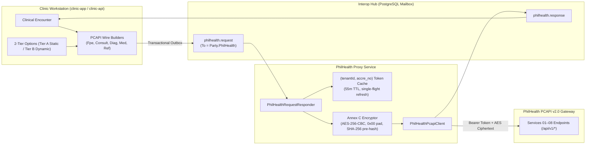

# PhilHealth Yakap PCAPI v2.0 Integration Expert Skill

PhilHealth Yakap PCAPI v2.0 (`rev20261026`) governs all electronic primary care benefits in the Republic of the Philippines under Republic Act No. 11223 (Universal Health Care Act). It supersedes the legacy Konsulta v1.14 XML/SOAP batch transmittal system with real-time RESTful APIs secured by Annex C cryptography.

This skill provides the definitive implementation standard for ClinicEZ services (`clinic-api`, `philhealth-proxy`, `portal-api`, `patient-api`, `portal-web`, and `clinic-app`).

---

## 1. Architectural Architecture & Core Data Flow



---

## 2. PCAPI v2.0 Services Summary (Services 01–08)

| Service # | Endpoint | Description | Payloads / Annexes |
|---|---|---|---|
| **01: PCU** | `POST /api/v1/pcu`<br/>`POST /api/v1/pcu/verify` | Patient Confirmation Unit biometric facial liveness | `PcuStartRequest`<br/>`PcuVerifyRequest` |
| **02: Validator** | `POST /api/v1/philhealth-yakap-validator` | Validates patient PhilHealth standing and active registration | `YakapValidateStandingRequest` |
| **03: Empanelment** | `POST /api/v1/yakap-empanelment` | Empanels patient to facility; generates `yes_reference_no` (`MCA...`) | `YakapEmpanelmentRequest` |
| **04: Selection** | `POST /api/v1/yakap-selection` | Assigns encounter to facility; generates K-transaction number | `YakapSelectionRequest` |
| **05: Masterlist** | `POST /api/v1/yakap-selection-masterlist/individual`<br/>`POST /api/v1/yakap-selection-masterlist/batch` | Queries individual or 7-day batch masterlist of assigned beneficiaries | `MasterlistIndividualRequest`<br/>`MasterlistBatchRequest` (max 7d) |
| **06: Data Upload** | `POST /api/v1/yakap-data-upload/{form}`<br/>`GET /api/v1/yakap-data-upload/{txNo}` | Encrypted clinical form upload and 23B transaction polling (`U...`) | Annex A: FPE<br/>Annex B: Consultation<br/>Annex C: Diag Request<br/>Annex D: Diag Results<br/>Annex E: Medicine<br/>Annex F: Referral |
| **07: Patient OTP** | `POST /api/v1/yakap-patient-verification-code` | Validates SMS One-Time PIN for verification | `VerificationCodeRequest` |
| **08: Availment Slip** | `POST /api/v1/yakap-availment-slip` | Generates encrypted Electronic Konsulta Availment Slip (eKAS PDF) | `AvailmentSlipRequest` -> Encrypted PDF |

---

## 3. Annex C Cryptographic Standards

Every clinical payload uploaded under Service 06 and every eKAS PDF downloaded under Service 08 is wrapped in an Annex C envelope:

```json
{
  "docMimeType": "application/json",
  "hash": "e3b0c44298fc1c149afbf4c8996fb92427ae41e4649b934ca495991b7852b855",
  "key1": "",
  "key2": "",
  "iv": "3q2+7w==...",
  "doc": "9xL4k..."
}
```

### Encryption Rules:
1. **Cipher Algorithm**: `AES-256-CBC`.
2. **Padding**: **`0x00` null-byte padding only**.
   - Use `PaddingMode.None`. Calculate `padLen = (16 - (plainBytes.Length % 16)) % 16`.
   - If `plainBytes.Length % 16 == 0`, append **zero** bytes.
3. **Pre-Encryption SHA-256 Hash**:
   - Compute `SHA256(plainBytes)` on the **unpadded plaintext bytes**.
   - Encode as a 64-character lowercase hexadecimal string: `Convert.ToHexString(hash).ToLowerInvariant()`.
4. **PDF Handling**:
   - For `"application/pdf"`, strip trailing whitespace and `%%EOF` markers during decryption if required.
5. **Reference Test Vector**:
   - Validated against Implementation Guide p.146 vector `PCAPI-TEST-CIPHER-KEY-0001`.

---

## 4. 2-Tier Data-Driven Option Architecture

ClinicEZ eliminates all hardcoded static option arrays in frontend clients:

- **Tier A (Static Options)**:
  - Source of Truth: `packages/shared-dotnet/Options/EhrStaticOptions.cs`.
  - Canonical descriptors (`EhrOptionDescriptor`) with standard `Code`, `Label`, `PhilHealthCode`, and `PhilHealthLibrary`.
  - Served via `GET /public/options`, `GET /api/v1/options`, and `GET /options` with deterministic SHA-256 `ETag`. Clients cache responses and send `If-None-Match`, receiving `304 Not Modified` on cache hits.
- **Tier B (Dynamic Catalogs)**:
  - ICD-10 (`lib_icd`), Drug Formulary (`lib_medicine`), and 10-Digit PSGC Locations (`PsgcLocation`).
  - Stored in database, queryable with pagination and autocomplete.

---

## 5. Zero-PHI Architectural Rules

To guarantee patient privacy and statutory compliance (RA 10173 & RA 11223):
1. **Cloud Control Plane (`portal-api` / `portal-web`) NEVER handles PHI**:
   - Forbidden: `PatientName`, `PhilHealthPin`, `PrimaryDiagnosis`, raw `<PCB>` XML or unencrypted PCAPI JSON.
   - Permitted: `PatientCode`, `SubmissionType`, 23B `LocalTransactionNo`, 23B `UploadTransactionNo` (`U...`), `YesReferenceNo` (`MCA...`), `ProcessingStatus`, `PayloadSha256Hash`, and statutory field error codes/messages.
2. **Edge Isolation**:
   - Patient records and clinical notes reside exclusively within the clinic's local Edge Cell database.
   - Portal queries (`yakap.submission.requested`) are answered by `YakapSubmissionResponder`, which projects clinical records into Zero-PHI DTOs before dispatching envelopes over the Interop Hub.
