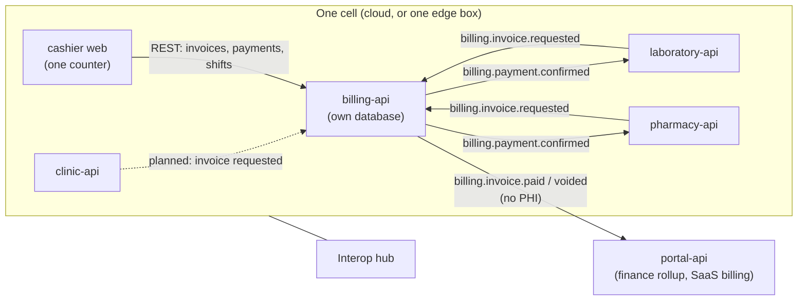
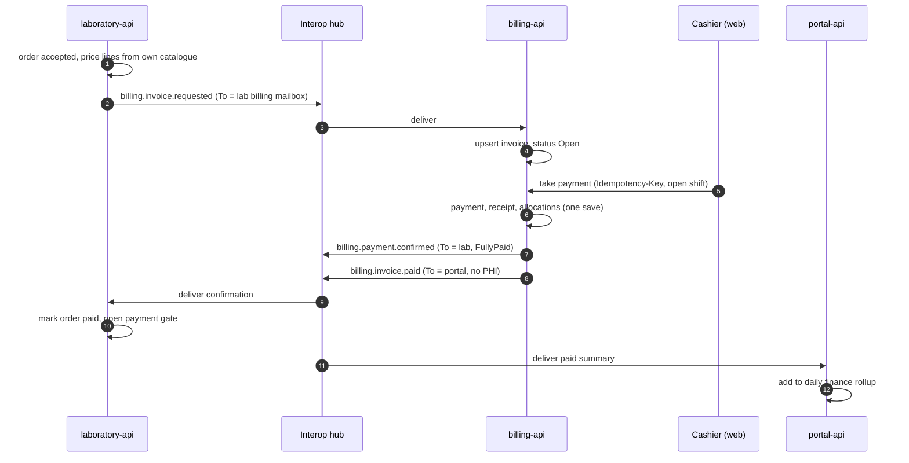

# Billing architecture

> Engineering notes, not legal or tax advice. This document describes what the code does today and marks what is still planned. It was written while `services/billing-api` was still being built: the **Domain** and **Application** layers exist, the **Api** and **Infrastructure** projects were still empty `.csproj` files. Check the [implementation status](#implementation-status) table before relying on a feature.

There are three unrelated things called "billing" in this repository. Do not mix them up.

| Name | Where | What it is | Related to cashiering? |
|------|-------|------------|------------------------|
| **Per-cell cashiering** | [`services/billing-api`](../../services/billing-api) | Invoices, payments, receipts, cashier shifts for patient care. Subject of this document. | Yes |
| **SaaS billing** | [`services/portal-api` `Features/Billing`](../../services/portal-api/ClinicEz.Portal.Application/Features/Billing) | What a tenant pays Clinic EZ (plans, subscriptions, Xendit checkout and webhooks). Stays in the portal. | No |
| **Clinic-local cashiering** | [`services/clinic-api` `Features/Billing`](../../services/clinic-api/ClinicEz.Clinic.Application/Features/Billing) | The clinic's original invoice and payment feature (`api/v1/billing/invoices`). Independent of billing-api. | Legacy, overlaps |

## Principles

1. **One cashiering service per cell.** The cloud cell runs one multi-tenant `billing-api`; every edge cell runs its own (see [`deploy/edge/docker-compose.yml`](../../deploy/edge/docker-compose.yml), where `billing-api` is in the "always runs" set). It is not a hub service and it does not stretch across cells.
2. **One counter for clinic, laboratory and pharmacy.** Each facility asks billing to invoice its work; the cashier collects it together. A clinic-only tenant still needs billing-api (it can also create walk-in invoices directly).
3. **The facility owns the clinical fact, billing owns the money.** A facility decides *what* to charge (lines, quantities, prices from its own catalogue). billing-api owns the invoice number, discounts, payments, receipts, refunds and shift totals. The facility only learns *that* it was paid.
4. **Messages carry minimum data.** Facility to billing carries the patient name/id and lines (billing needs them to print a bill). Billing to the portal carries **no PHI**, only totals.
5. **All sends go through the outbox.** Every `billing.*` message is enqueued before `SaveChanges`, so it commits atomically with the payment or invoice change (see [platform-contract.md](platform-contract.md)). A payment and its `billing.payment.confirmed` cannot diverge.

## Components and ownership

All arrows between services travel through the hub mailboxes (`Messaging__Service=billing` gives billing-api its own mailbox next to `clinic`, `laboratory`, ...). The cashier web app talks to billing-api over REST only.

| Concern | Owner | Notes |
|---------|-------|-------|
| What was ordered, catalogue price, which lines | The requesting facility | Lab prices from its own product catalogue ([`LabOrderBilling`](../../services/laboratory-api/ClinicEz.Laboratory.Application/Interop/LabOrderBilling.cs)); pharmacy from order items ([`PharmacyBillingPublisher`](../../services/pharmacy-api/ClinicEz.Pharmacy.Infrastructure/Services/PharmacyBillingPublisher.cs)). |
| Invoice, number, discounts, locking | billing-api ([`Invoice`](../../services/billing-api/ClinicEz.Billing.Domain/Entities/Invoice.cs)) | Per-facility document sequences ([`DocumentNumbers`](../../services/billing-api/ClinicEz.Billing.Application/Services/DocumentNumbers.cs)). |
| Payments, allocations, receipts, refunds | billing-api ([`PaymentService`](../../services/billing-api/ClinicEz.Billing.Application/Services/PaymentService.cs), [`CorrectionService`](../../services/billing-api/ClinicEz.Billing.Application/Services/CorrectionAndShiftServices.cs)) | |
| Cashier shifts and drawer variance | billing-api (`ShiftService`) | One open shift per cashier per counter. |
| Payment gate on the work | The facility | It reacts to `billing.payment.confirmed`; billing does not know the facility's workflow. |
| Workspace-wide finance totals | portal-api rollup (read-only) | Entities exist; see [status](#implementation-status). |
| SaaS subscription | portal-api + Xendit | Unrelated to patient payments. |
| Branch | A dimension (`BranchId`) on every invoice, payment, refund | Not a separate service or database. |

### Levels: facility, branch, workspace

| Level | What it means in billing |
|-------|--------------------------|
| **Facility** | The unit of invoice numbering, cashier counter and shift. Staff sign in to *their own counter's* facility; tenant, facility, user, role and permissions come only from the validated token ([`BillingCaller`](../../services/billing-api/ClinicEz.Billing.Application/Abstractions/IBillingDbContext.cs)). Invoices of the whole tenant are visible to a cashier in the same tenant (queries filter by tenant, with optional facility/branch filters), which is what makes one counter serve three facilities. |
| **Branch** | Filter/reporting dimension. It also scopes visit bills: invoices of different branches are never merged. |
| **Workspace** (tenant) | Read-only consolidated totals in the portal, built from `billing.invoice.paid` / `billing.invoice.voided`. Never a place where money is taken. |

## Invoice lifecycle

Statuses: `Open`, `PartiallyPaid`, `Paid`, `Void`, `Refunded`. Origin: `Requested` (came from a facility message) or `WalkIn` (created at the counter).

- **Created** from `billing.invoice.requested` ([`InvoiceRequestedHandler`](../../services/billing-api/ClinicEz.Billing.Application/Interop/InvoiceRequestedHandler.cs)) or by a cashier ([`InvoiceService.CreateWalkInAsync`](../../services/billing-api/ClinicEz.Billing.Application/Services/InvoiceService.cs)); a walk-in invoice needs an amount due.
- **Idempotent by request id.** The key is (tenant, facility, `InvoiceRequestId`). Re-sending the same id **replaces the lines only while the invoice is unlocked**; a locked invoice is left alone.
- **Locked** as soon as anything is paid or the status is not `Open`: lines and discounts can no longer change.
- **Zero-total requests** (for example a test the lab could not price) settle on arrival and immediately answer `billing.payment.confirmed`, so the facility is not blocked. Unpriced lab tests are sent with price 0 so the cashier can see them; the cashier cannot reprice a locked invoice.
- **Discounts**: statutory senior citizen / PWD discount is a fixed 20% (RA 9994 / RA 10754) and needs the ID number; only one statutory discount per invoice; promo and other discounts need supervisor approval (`billing:approve`).
- **Void** (nothing paid) and **Refund** (gives back everything paid) are supervisor actions with a mandatory reason, audited. A cash refund needs an open shift because the money leaves the drawer.
- Money uses 2-decimal `Money` rounding; currency defaults to `PHP`.

### Handler trust rules (`billing.invoice.requested`)

The handler accepts a request only if all hold; otherwise it is acknowledged and logged (a bad message must not block the mailbox):

- `From` is a facility party whose tenant and facility equal the payload;
- `To` is the same facility's `billing` mailbox (`To.Service = billing`);
- the payload `FacilityType` matches the address;
- `InvoiceRequestId` is non-empty;
- every line is valid (invalid lines are logged and skipped).

The first accepted request also registers a `BillingFacility` row (type of that facility), which later lets the counter create walk-in invoices.

### Consolidated visit bill

One payment can cover several invoices of a visit. [`VisitBillGrouper`](../../services/billing-api/ClinicEz.Billing.Domain/Services/VisitBillGrouper.cs) groups invoices with the same **tenant + branch + visit key + currency + patient**:

- the visit key is chosen by the facilities (clinic encounter / queue id) and travels in `BillingInvoiceRequestedPayload.VisitKey`;
- invoices **without a visit key are never merged**;
- patient match uses `PatientId` first, then falls back to a normalised name; if two different patients share a name in the same visit it **does not guess** and keeps the invoice on its own bill.

Payment allocation ([`PaymentAllocator`](../../services/billing-api/ClinicEz.Billing.Domain/Services/VisitBillGrouper.cs)): **oldest invoice first** by default, or **explicit** amounts per invoice that must add up to the payment and stay within each balance. A payment cannot exceed the visit balance (no overpayment, no change-as-credit). All invoices of one payment must belong to the same visit bill.

### Taking a payment

[`PaymentService.TakeAsync`](../../services/billing-api/ClinicEz.Billing.Application/Services/PaymentService.cs):

1. `Idempotency-Key` header is required (max 100 chars). A repeat with the same key and same request returns the original payment (`replay = true`); the same key with a different request is a `409`. A parallel race on the unique index is resolved to the winner's payment.
2. Requires an **open cashier shift** for this cashier at this counter.
3. Methods: `Cash`, `Card`, `GCash`, `Maya`, `Other`, `Insurance`. Non-cash methods and insurance need a `Reference`; insurance also needs the insurer kind (PhilHealth / HMO / other) and is flagged **external** (money not in the drawer), so shift totals separate cash, non-cash and external.
4. In **one** save it writes the payment, per-invoice allocations, one official receipt (per-facility sequence), the audit entry, and enqueues the messages below.

Concurrent edits of the same invoice or receipt book surface as a conflict (optimistic concurrency); the cashier retries with the same key.

## Message flows

| Type | From, To | Correlation id | Contains |
|------|----------|----------------|----------|
| `billing.invoice.requested` | facility → that facility's `billing` mailbox | `InvoiceRequestId` | tenant, facility, type, branch, patient id/name, visit key, source type/id, lines, currency |
| `billing.payment.confirmed` | facility's billing party → the facility | `InvoiceRequestId` | invoice id, amount due / paid, `FullyPaid`, method, receipt number, paid time |
| `billing.invoice.paid` | billing → `Party.Portal` | `InvoiceId` | tenant, facility, type, branch, invoice id, source type, total, currency, paid time. **No PHI.** |
| `billing.invoice.voided` | billing → requesting facility, and → portal if the invoice had been fully paid | `InvoiceRequestId` (facility) / `InvoiceId` (portal) | kind (`Void`/`Refund`), total, amount reversed, `WasFullyPaid`, ids. No patient data. |

Payload records live in [`ClinicalWorkflowContracts.cs`](../../packages/shared-dotnet/Interoperability/ClinicalWorkflowContracts.cs) and [`BillingVoidContracts.cs`](../../packages/shared-dotnet/Interoperability/BillingVoidContracts.cs); type strings in [`InteropTypes.cs`](../../packages/shared-dotnet/Interop/InteropTypes.cs).

Rules, taken from [`BillingMessages`](../../services/billing-api/ClinicEz.Billing.Application/Interop/BillingMessages.cs):

- `billing.payment.confirmed` is sent **only for `Requested`-origin invoices** and is sent on **every** payment including partial ones (`FullyPaid = false`); walk-in invoices have no requesting service and send nothing to a facility.
- `billing.invoice.paid` is sent once an invoice becomes `Paid`, and skipped when `Total <= 0`.
- `billing.invoice.voided` to the portal is sent only when the invoice **had been fully paid**, because the rollup only ever heard about those; the payload's `AmountReversed` is what the rollup subtracts.

### Facility-side payment gate

Both implemented gates only accept the confirmation from **their own billing mailbox** (`From.Service = billing`, same tenant and facility as `To`); anything else is acknowledged and ignored.

| Facility | Policy | Behaviour |
|----------|--------|-----------|
| Laboratory ([`BillingPaymentConfirmedHandler`](../../services/laboratory-api/ClinicEz.Laboratory.Application/Interop/BillingPaymentConfirmedHandler.cs)) | `PaymentPolicy`: `Prepaid` (blocks work until paid), `Postpaid` (invoice raised, work not blocked), `None` (no invoice) | Finds the order by `InvoiceRequestId` (= requisition id). Partial payment keeps the order unpaid. Full payment stamps paid time, invoice id and receipt number and moves the stage to `Paid` (for an order already being worked on only the payment fields change). Idempotent. |
| Pharmacy ([`BillingPaymentConfirmedHandler`](../../services/pharmacy-api/ClinicEz.Pharmacy.Application/Interop/BillingPaymentConfirmedHandler.cs)) | `PharmacyPaymentPolicy`: `Prepaid` (confirm before dispensing), `Postpaid`, `None` | Only for source type `Prescription` and an order `AwaitingPayment`. Records `PaidAmount` on every payment; sets `Paid` plus receipt number once `FullyPaid`. The invoice is requested when the order is accepted after review. |

Unknown order ids are not retried: a payment can only follow its request, so they are logged and acknowledged.

## Offline and edge behaviour

- Billing runs **inside the cell**, so a clinic on an edge box can invoice, take cash and print receipts with no internet. Messages to the portal (`billing.invoice.paid` / `voided`) wait in the outbox and flow when the edge connects.
- Facility-to-billing messages are same-cell, so they depend only on the local hub (see [interop-hub.md](interop-hub.md) for delivery semantics: at-least-once, idempotent handlers).
- The edge compose file passes `Messaging__*` credentials and its own `CLINICEZ_BILLING_DB` (included in the `backup` service's database list) and ships an optional `cashier` profile for the cashier web image.

## Cross-cell limits (v1)

- **No cross-cell consolidation.** A lab in another cell invoices *in its own cell's* billing-api; the patient pays there. `VisitBillGrouper` only groups what reached one billing-api.
- Cross-cell lab orders therefore pay at the performing lab's counter; the ordering clinic only sees the lab's status messages.
- The workspace total is the sum of what each cell reported to the portal. It is eventually consistent and is not the ledger.

## Security and privacy notes

- Tenant isolation: every query filters by `TenantId` from the token; message handlers scope to the recipient facility explicitly.
- Role model: `Cashier` (read/create invoices, statutory discounts, take payments, manage own shifts), `Supervisor` (adds `billing:approve` and `reports:read`), `Admin` (all, including `staff:manage`). The portal's internal-service principal may only manage staff accounts.
- Invoices contain patient name and (optionally) patient id, so billing-api is a PHI store of its cell; the portal never receives it (see [data-ownership.md](data-ownership.md)).
- Everything that changes money is written to an audit trail (`payment.taken`, `invoice.voided`, `invoice.refunded`, `shift.opened`, `shift.closed`, ...).

## Implementation status

State as read from the working tree, not a promise.

| Area | Status |
|------|--------|
| Domain: invoice, lines, discounts, locking, void/refund, payments, allocation, cashier shift, `Money`, visit grouper, permissions | Implemented |
| Application services: invoice, payment, void/refund, shifts, visit bill, discounts, audit, document numbers | Implemented |
| `billing.invoice.requested` handler (billing side) | Implemented |
| `billing.payment.confirmed` / `invoice.paid` / `invoice.voided` producers | Implemented |
| Laboratory: request invoice + payment gate | Implemented (`RefreshInvoiceAsync` exists on `ILabOrderBilling` but nothing calls it yet) |
| Pharmacy: request invoice + payment gate | Implemented |
| billing-api **Infrastructure** (EF `DbContext`, migrations, DI, interop wiring) | Not present yet (empty project) |
| billing-api **Api** (`Program`, REST endpoints, token validation, health) | Not present yet (empty project) |
| billing-api tests | Not present yet (empty project) |
| Clinic requesting an invoice from billing-api | **Implemented.** Configured via `ClinicSettings.CashierMode` (`ClinicDesk` vs `CashierCounter`). In `CashierCounter` mode, `CreateInvoiceCommand` and `UpdateInvoiceCommand` dispatch `billing.invoice.requested` to `billing-api`. In `ClinicDesk` mode, invoices remain local for in-clinic cashiering. |
| Clinic desk SOA review & update (`UpdateInvoiceCommand`) | **Implemented.** `PUT api/v1/billing/invoices/{id}` allows editing line items, applying Senior Citizen/PWD statutory discounts, and re-publishing to `billing-api` when counter-owned. |
| Post-Encounter Workstation Action Dialog | **Implemented.** Non-disruptive post-sign modal in `Consultations.screen.tsx` prioritizing "Call Next Patient" while offering direct navigation to billing and prescription printing. |
| Portal rollup | Entities exist (`FinanceDailySummary`, `FinanceInvoiceRecord`: per facility, day, source type; idempotent per invoice). **No handler** is registered for `billing.invoice.paid` or `billing.invoice.voided` in portal-api, so nothing fills the rollup yet |
| `daybook.closed` summary (in the original plan) | Not implemented |
| Cashier web screen (`apps/cashier-app`) | Not present; compose references a `cashier-web` image published "once apps/cashier-app lands" |
| `deploy/billing-api/docker-compose.yml` | Referenced by [`deploy/README.md`](../../deploy/README.md) but not present in the tree when checked; the edge compose already includes `billing-api` |
| Hub client for billing | Dev bootstrap has a `dev-billing` client; production clients are created through the hub admin API like any other service |
| Insurance (PhilHealth/HMO) claim processing | Not implemented: `Insurance` is only a payment method flagged as external |

### Known gaps and cautions

- Until billing-api's Api and Infrastructure land, `billing.invoice.requested` from lab and pharmacy has no consumer, so a `Prepaid` order waits for a payment that can never arrive. Keep lab/pharmacy on `PaymentPolicy.None` for tenants without a running billing-api, or deploy billing-api first. (The lab default `LabSettings.PaymentPolicy` and pharmacy default are `Prepaid`.)
- Two cashiering systems exist for the clinic (clinic-api's own and billing-api's). Pick one per tenant to avoid double counting; the portal rollup only ever sees billing-api.
- portal-api has no handler for `billing.invoice.paid` / `billing.invoice.voided`. A message with no registered handler is not acknowledged, so the hub redelivers it and finally dead-letters it (see [interop-hub.md](interop-hub.md)). Add the portal handlers before billing-api starts sending to production portals.
