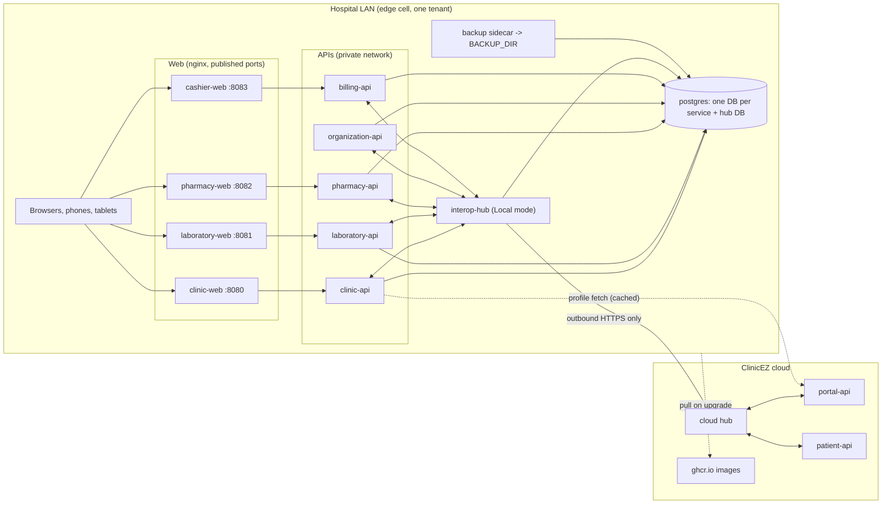
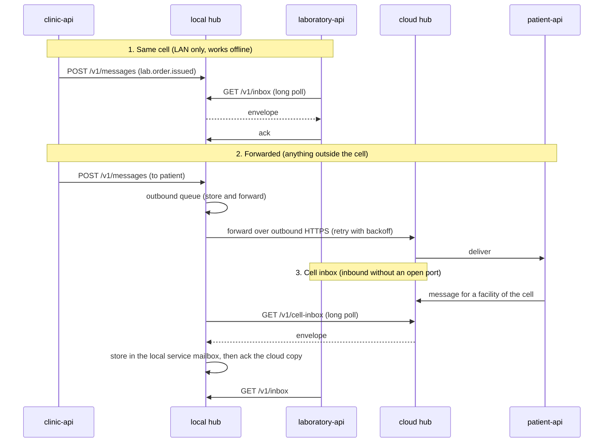

# Edge Cell: the on-premise bundle

An **edge cell** is everything one on-premise tenant site runs on its own server: its facility APIs and web apps, a PostgreSQL
database with backups, and a **local interop hub**. It is the deployment shape behind decision D6 of the architecture plan
(air-gapped / LAN-only sites are possible) and plan sections 4.5.1 and 4.11. The runbook is
[deploy/edge/README.md](../../deploy/edge/README.md); the bundle lives in `deploy/edge/`.

An edge cell serves **exactly one tenant**. It is the on-prem counterpart of the *cloud shared cell*, which hosts every SharedCloud
tenant behind the cloud hub.

## Components

### What runs where

| Where | What | Notes |
|---|---|---|
| Edge host, always | `postgres`, `backup`, `billing-api`, `clinic-api`, `clinic-web` | `billing-api` serves the single cashier counter of the cell (decision D5). |
| Edge host, profile `local-hub` | `interop-hub` (same image as the cloud hub, `Hub:Mode=Local`) | On by default. Mailboxes live in the cell's postgres (`CLINICEZ_INTEROP_HUB_LOCAL_DB`), no broker anywhere. |
| Edge host, profiles `laboratory` / `pharmacy` / `organization` / `cashier` | the matching API and web app | Switched on per facility the tenant owns. |
| Cloud | cloud hub, portal-api (facility registry, licenses, credentials), patient-api, GHCR | The cell never needs an inbound connection from any of them. |
| Devices | Native clinic/lab/pharmacy apps and browsers | They use the web port of their facility: nginx proxies `/api/` to the API, so APIs publish no host port. |

Only the web ports (and optionally the hub, loopback by default) are published. Everything else is on the private compose network.

`patient-api` is cloud-only: the bundle does not contain it, so a site needs neither its signing key (`Sharing__SigningKey`) nor its database. Patients reach the site through the hub (messages for the site's facilities arrive via the cell inbox).

## Data flow

Every facility service has **one** hub address, `Messaging__HubUrl`, and with the local hub it always points at the cell's hub (`http://interop-hub:8080`; a single-facility site without a hub points it at the cloud hub, see below).
Facility code never knows whether a peer is local or remote.

1. **Same cell** (clinic <-> lab <-> pharmacy <-> billing): delivered entirely on the LAN. No internet, no cloud copy, no cross-tenant policy check (always same tenant).
2. **Forwarded** (online site, `UPSTREAM_ENABLED=true`): anything else (patient app, portal, another tenant's facility) is queued in the hub's outbound table, then sent oldest-first per correlation id over **outbound HTTPS** with exponential backoff, deduplicated by `MessageId` at the cloud. Each service also has its own transactional outbox, so a facility keeps working even if the hub is down. On an air-gapped site such messages are **rejected** (`upstream_disabled`), not queued.
3. **Cell inbox**: the cloud delivers messages for the cell's facilities into one `cell-inbox`; the local hub long-polls it, copies each message into the addressed local service mailbox and only then acks the cloud copy.

The local hub also syncs a read-only **directory/entitlement snapshot** so the clinic can still list "send to Lab 1" offline. Claims for patient-carried slips are proxied to the cloud and fail with `502` while it is unreachable (`503` on an air-gapped site, where there is no upstream at all).

## Offline behaviour

| Traffic | Internet down |
|---|---|
| clinic <-> lab <-> pharmacy <-> billing, web apps, native apps on the LAN | works normally |
| Messages to the patient app, portal, other tenants | online site: wait in the hub (and service outbox), delivered in order on reconnect. Air-gapped site (`UPSTREAM_ENABLED=false`): rejected with `upstream_disabled`, never queued |
| Messages from the cloud to the cell | wait in the cloud mailbox (TTL 7 days) |
| Workspace profile (branding, letterheads) | the copy each service stored in its own database when the portal pushed it (`workspace.profile.updated`); nothing is fetched, so the site never calls the portal. Before the first message arrives the built-in branding is used |
| License | valid until it expires; expiry gives a read-only grace period; renewal by heartbeat or file import |
| Upgrades | need `ghcr.io`, or an air-gapped `docker load` |

## License, activation and heartbeat

- Each facility has **one license** (decision D7), a signed token `<payload>.<signature>` verified locally against the authority public key configured as `FacilityLicense__PublicKeyPem` (`FACILITY_LICENSE_PUBLIC_KEY`, handed out by the portal operator; `FacilityLicenseValidator`), so verification needs no network.
- **First-run activation** is `POST /api/v1/license/apply` on the facility API (anonymous bootstrap endpoint, reachable through the web container), done by `install.sh` / `install.ps1` from a token or a license **file**. The API stores the token, plan tier, limits and expiry in its database (`ClinicSettings`/equivalents). `GET /api/v1/license` exposes the state: `Active`, `ActivationRequired`, `Expired`, `Tampered`.
- **Heartbeat** (online sites): the portal records `LastSeenAt` and `AppVersion` per facility (plan phase 4, "license heartbeat"), which also gives support a health view of on-prem nodes. Renewal rides on it. Air-gapped sites renew by **file import** (decision D6): the same activate command with the new file.

## Upgrade channel

Images are published to GHCR (`ghcr.io/<owner>/<repo>/<service>:<tag>`, amd64 and arm64, version tags plus `latest`) for `clinic-api`, `laboratory-api`, `pharmacy-api`, `organization-api`, `billing-api`, `interop-hub`, `clinic-web`, `laboratory-web`, `pharmacy-web` and `cashier-web`. `install.sh upgrade --tag X` backs up, pulls and recreates; services migrate their database at start. The tag is pinned in `.env`, so a site only changes version when its operator asks. Rollback is `upgrade` with the previous tag.

## Credentials

Two kinds of credentials exist and they must not be confused: the ones the **portal** issues, and the **local** ones the installer generates. Which is used depends on the hub mode.

| Mode | Credential | Created by | Used for | Where it lives |
|---|---|---|---|---|
| Local hub (default) | **Upstream client**, ONE per cell, service `cell`: **`HubEdgeCredentials`** (`HubUrl`, `ClientId`, `ClientSecret`) | **Portal** (`HubOnboardingService`, an `EdgeCell` client of the tenant's cell, shown once, rotatable) | The local hub's **upstream** link to the cloud hub (not used with `UPSTREAM_ENABLED=false`) | `.env`: `UPSTREAM_HUB_URL`, `UPSTREAM_CLIENT_ID`, `UPSTREAM_CLIENT_SECRET` -> `Hub__Upstream__*`. **Not** in `hub-bootstrap.env` |
| Local hub (default) | **Local clients**, one per service (`site-clinic`, `site-billing`, `site-laboratory`, ...) | **Installer**, generated on the host | Each facility service authenticating to the local hub | `.env`: `<SERVICE>_HUB_CLIENT_ID/SECRET` -> `Messaging__ClientId/ClientSecret`; the same values in `hub-bootstrap.env` -> `Hub__Bootstrap__Clients__N__*` |
| Local hub (default) | **License authority public key** (one per portal environment) | **Portal operator** (`scripts/generate-license-keys`; only the public half leaves the portal) | Every service that validates licenses (clinic, laboratory, pharmacy, organization) | `.env`: `FACILITY_LICENSE_PUBLIC_KEY` (+ optional `FACILITY_LICENSE_PUBLIC_KEY_PREVIOUS`) -> `FacilityLicense__PublicKeyPem` / `__PreviousPublicKeyPem`. Required, also with `--air-gapped` and `--no-local-hub` |
| Local hub (default) | **Edge hub signing key** (ECDSA P-256 private key), issued with the upstream client | **Portal** (its public half is registered at the cloud hub for that client) | Signs the envelopes the local hub sends upstream | `.env`: `EDGE_HUB_SIGNING_KEY` -> `Hub__Upstream__SigningKey`. Not needed with `UPSTREAM_ENABLED=false` |
| Local hub (default) | **Local client signing key pairs**, one per service | **Installer**, generated on the host | Each service signs its envelopes; the local hub verifies them (`Hub__Signing__Required`) | `.env`: `<SERVICE>_HUB_SIGNING_KEY` (private -> `Messaging__SigningKey`) and `<SERVICE>_HUB_PUBLIC_KEY`; the public half also in `hub-bootstrap.env` -> `Hub__Bootstrap__Clients__N__PublicKey` |
| No local hub (`--no-local-hub`) | **Per-service clients** for clinic and billing, plus the cloud hub URL | **Portal** (ids as returned; no `site-` prefix, never generated or defaulted by the installer) | `clinic-api` / `billing-api` authenticating to the cloud hub | `.env`: `HUB_URL`, `CLINIC_HUB_CLIENT_ID/SECRET`, `BILLING_HUB_CLIENT_ID/SECRET` -> `Messaging__*`, plus the portal-issued signing keys `CLINIC_HUB_SIGNING_KEY` / `BILLING_HUB_SIGNING_KEY` -> `Messaging__SigningKey`. No `UPSTREAM_*`; `hub-bootstrap.env` is comment-only |

Also in `.env`: `TENANT_ID`, `EDGE_CELL_ID`, the facility ids, `CLINIC_PUBLIC_UPLOAD_BASE_URL`, the license (activation step), and generated `POSTGRES_PASSWORD`, per-service `*_JWT_SIGNING_KEY` (required, no generated-on-disk fallback), `CLINIC_DOCUMENT_SIGNING_KEY` / `LABORATORY_DOCUMENT_SIGNING_KEY` (verification QR codes), `GAMOT_UPSC_SECRET_KEY`, `CLINIC_ENCRYPTION_MASTER_SECRET` (wraps the per-file keys of the clinical records: required, never replace it without moving the old value to `CLINIC_ENCRYPTION_PREVIOUS_MASTER_SECRET_0`, keep a copy of `.env`), `HANGFIRE_DASHBOARD_PASSWORD`, `HUB_PAYLOAD_ENCRYPTION_KEY`. Rotation procedures: [deploy/edge/README.md](../../deploy/edge/README.md#keys-and-rotation).

`CLINIC_PUBLIC_UPLOAD_BASE_URL` (`--public-upload-url`) is the public URL of the lab-result upload page printed on lab slips (`Clinic__PublicUploadBaseUrl`, `{base}/{token}`). That page is a cloud page: the site only needs outbound access, and uploaded results are relayed back to the clinic through the hub. Lab orders cannot be issued without it, so the installer asks for it (it may stay empty only on an air-gapped site, with a warning).

The hub applies `Hub:Bootstrap` at every start (idempotent): the cell, one `EdgeCell` client per enabled service and the site's facilities, so it can route before its first directory sync.

## Security

- **No inbound exposure**: the cell only dials out (hub forwarder, cell-inbox long poll, directory sync, portal profile fetch, GHCR pulls).
- Per-site, per-service hub clients; secrets are at least 24 characters and stored hashed by the hub. A compromised service client cannot send as another cell.
- PHI at rest: hub envelopes are AES-256-GCM encrypted when `HUB_PAYLOAD_ENCRYPTION_KEY` is set; scanned records are stored encrypted by the application; backups hold both databases and record archives, so protect them as PHI.
- Intra-hospital PHI never leaves the site (same-cell traffic is LAN-only).
- LAN transport is plain HTTP by default; terminate TLS in front of the web ports for untrusted segments.
- Secrets live in `.env` / `hub-bootstrap.env` (mode 600, git-ignored) and are not in backups by design.

## Single-facility versus multi-facility cells

| | Cell with `local-hub` (default) | Single facility, no local hub (`--no-local-hub`) |
|---|---|---|
| Facility services' `Messaging__HubUrl` | `http://interop-hub:8080` | the cloud hub URL (`HUB_URL`) |
| Clients of the services | local `site-<service>` clients, generated by the installer | the portal-issued per-service clients: clinic and billing (`CLINIC_HUB_CLIENT_*`, `BILLING_HUB_CLIENT_*`) |
| Client held by the site towards the cloud | ONE upstream client (service `cell`) of the hub, `UPSTREAM_*` | none beyond the two above |
| Intra-site messaging | LAN, offline-capable | via the cloud (outbox buffers during outages) |
| Other facilities (lab, pharmacy, organization) | supported | not supported (installer refuses them) |
| Air-gapped | supported (`UPSTREAM_ENABLED=false`) | refused |
| Adding a second facility | already supported | re-run the installer without `--no-local-hub`, with the upstream credentials |

Several facility stacks of one site share **one** hub: expose it with `HUB_BIND=0.0.0.0` and point the other stacks' `HUB_URL` at it.

## Air-gapped mode

No cloud link at all (decision D6): `--air-gapped` / `-AirGapped` sets `UPSTREAM_ENABLED=false` in `.env` (default `true`), passed to the hub as `Hub__Upstream__Enabled`. In Local mode the hub then needs **no upstream settings** (no placeholders, no dummy secret) and never forwards, pulls or syncs.

- Same-cell traffic works as usual on the LAN.
- Messages for a non-local target (another cell, the portal, a patient) are **rejected with reason `upstream_disabled`, not queued**; nothing waits for a link that will not come.
- The hub's claims endpoints answer **`503`**.
- Licenses are imported from file, images by `docker load`.
- It cannot be combined with `--no-local-hub` (without a hub the services call the cloud hub directly): the installer refuses it.

To connect the site later: `UPSTREAM_ENABLED=true`, the portal's `HubEdgeCredentials` as `UPSTREAM_*`, then `./install.sh apply`.

## Limits and open points

- **`billing-api` takes a smaller configuration than the other APIs**: only `ASPNETCORE_ENVIRONMENT`, the connection string, `Messaging__*`, `Facility__BaseDomain` and `Jwt__*`. The compose file mirrors `deploy/billing-api/docker-compose.yml` (no Hangfire, no workspace-profile cache, no portal URL). `cashier-web` is built from `apps/cashier-app/deploy/Dockerfile.web` by the `publish-images` workflow; it reads `/config.json` (`EXPO_PUBLIC_BILLING_API_URL`, default `/`) through the app's `services/runtimeConfig.ts` and nginx proxies `/api/` to `billing-api`.
- **What the portal must issue**: for a cell with a local hub, ONE upstream `EdgeCell` client with service `cell` (the hub README's convention) as `HubEdgeCredentials`; for a single facility without a local hub, per-service clients for `clinic` **and** `billing`. `HubOnboardingService` currently creates a client per facility service (e.g. `clinic`); the bundle takes whatever the portal hands out (`UPSTREAM_CLIENT_*`, or `CLINIC_HUB_CLIENT_*` / `BILLING_HUB_CLIENT_*`) and never invents ids, so the portal has to agree with this model before go-live.
- **Laboratory, pharmacy and cashier web apps** read only their API address from `/config.json` (`EXPO_PUBLIC_LAB_API_URL` / `EXPO_PUBLIC_PHARMACY_API_URL` / `EXPO_PUBLIC_BILLING_API_URL`, default `/`) through `services/runtimeConfig.ts`; nginx proxies `/api/` same-origin. Unlike clinic-web they have no stored-server-address screen for native devices yet.
- Single PostgreSQL instance and single host: no high availability; recovery is restore-from-backup.
- Backups are file dumps on the host (no off-site copy built in); ship `BACKUP_DIR` elsewhere.
- No built-in proxy support for the outbound link, and no TLS termination for the LAN web ports.
- The license file format is assumed to be the token text (or JSON with `licenseToken`).
