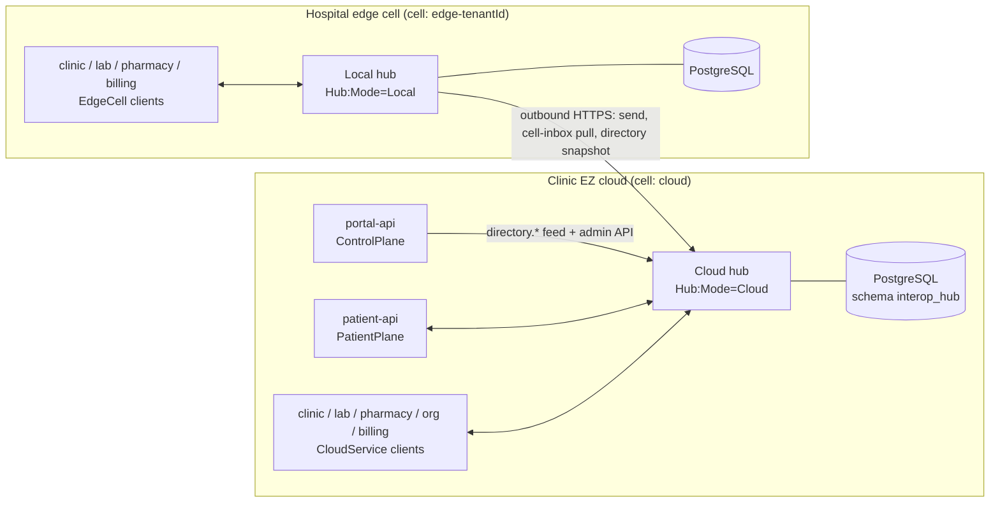
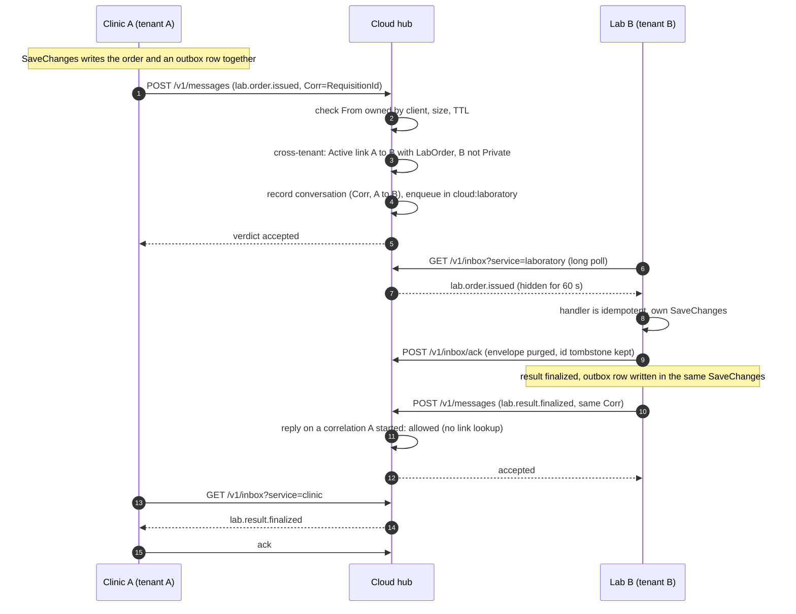
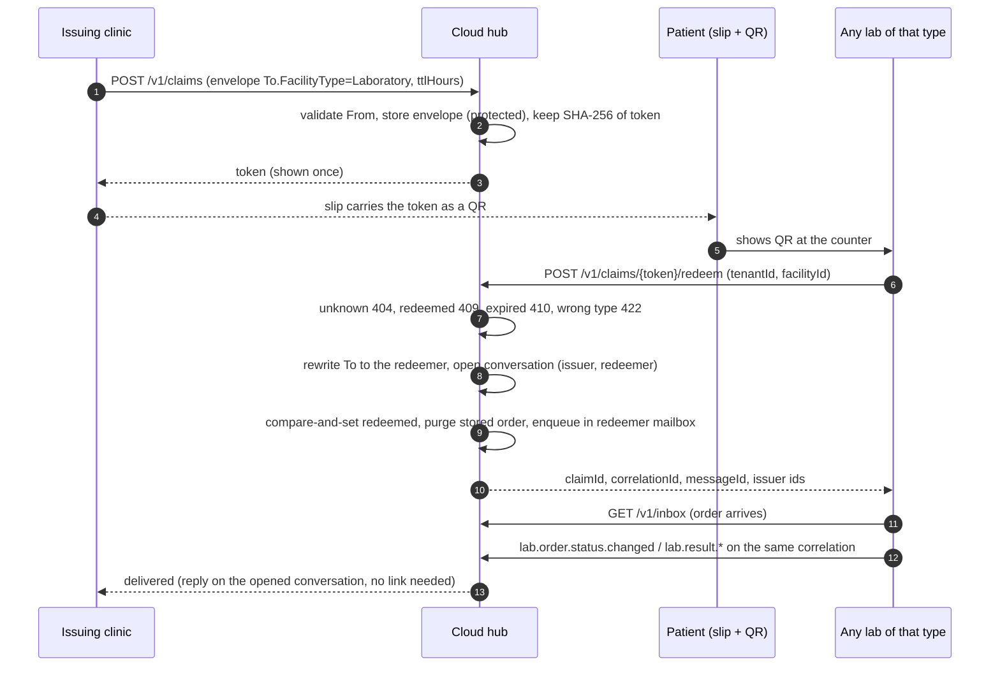
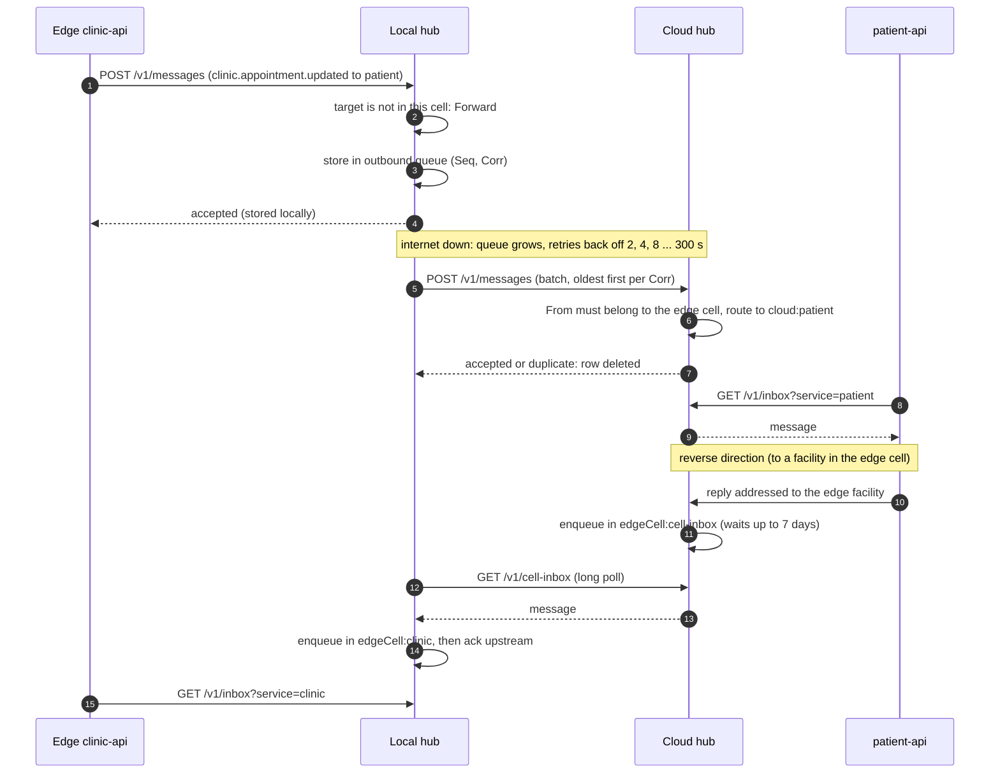

# Interop hub

The hub is the only way anything crosses a service or cell boundary in Clinic EZ. **Direct inter-service HTTP communication is strictly forbidden across all services except `portal <-> patient`**. Every facility service (`clinic-api`, `laboratory-api`, `pharmacy-api`, `organization-api`, `billing-api`) runs in outbound-only on-premise Edge Cells (`Hub:Mode=Local`, zero inbound ports) and MUST communicate exclusively via `services/interop-hub`. Services exchange [`InteropEnvelope`](../../packages/shared-dotnet/Interop/InteropEnvelope.cs) messages through HTTPS mailboxes held in PostgreSQL. Everybody who calls the hub calls it **outbound**, so an on-premise site needs no inbound port.

This document explains the model (mailboxes, cells, routing, delivery, federation, security). Endpoint tables, configuration keys and operations are in the [hub README](../../services/interop-hub/README.md); the SDK side is in [platform-contract.md](platform-contract.md).

> **What replaced what.** The RabbitMQ broker is gone: its job (addressing, mailbox, ack, retry, TTL) is done by hub mailboxes in Postgres. MassTransit (bus, consumers, EF outbox/inbox) is gone: it is replaced by the `ClinicEz.Shared.Interop` SDK (envelope, EF outbox/inbox tables `interop_outbox`/`interop_inbox`, relay, inbox poller, `IInteropHandler<T>`). `RABBITMQ_*` settings became `Messaging__*`. Direct service-to-service HTTP and webhooks (clinic to patient-api, portal to clinic, facilities reading the portal database) are replaced by envelopes. The only permitted direct HTTP link in the entire architecture is between the central cloud control plane and patient plane (`portal <-> patient`). Furthermore, Next.js BFF proxy routes (`src/app/api/...`) over `portal-api` or `patient-api` are strictly forbidden in `apps/portal-web`. `scripts/check-no-broker.ps1` fails the build if a broker reappears.

## Topology

One binary, two modes (`Hub:Mode`): `Cloud` is the authority (client auth, directory, routing policy, cross-tenant links, claims, mailboxes); `Local` serves the same wire API on the LAN, keeps same-cell traffic on the LAN, queues everything else for the cloud and pulls the site's cell inbox.

### Service Boundaries and Edge Cell Rationale

ClinicEZ enforces strict physical and network boundaries between deployment planes:
1. **Zero Inbound Ports on Edge Cells**: Every facility service (`clinic-api`, `laboratory-api`, `pharmacy-api`, `organization-api`, `billing-api`) can run in on-premise Edge Cells (`Hub:Mode=Local`). To preserve enterprise network security and operate reliably behind hospital firewalls, NATs, and transient WAN outages, Edge Cells open **zero inbound ports** and communicate outbound-only over HTTPS to the Interop Hub.
2. **Direct Inter-Service HTTP Prohibition**: Direct inter-service HTTP calls are strictly forbidden across all microservices. Services must never bypass the Hub to invoke peer APIs directly.
3. **Sole Direct HTTP Exception (`portal <-> patient`)**: Direct HTTP communication is permitted strictly between `portal-api` (Control Plane) and `patient-api` (Patient Plane) within the cloud control plane.
4. **Zero Next.js BFF Proxy Routes**: `apps/portal-web` is strictly prohibited from introducing Next.js BFF API proxy routes (`src/app/api/...`) over `portal-api` or `patient-api`. Client web applications connect directly to APIs using Clerk bearer tokens.

## Cells and mailboxes

A **cell** is a routing unit: a set of facilities sharing a hub.

| Cell kind | Hosts | Id | Hub |
|---|---|---|---|
| `Cloud` | All shared-cloud facilities of every tenant, patient-api, portal-api | `cloud` (`Hub:CloudCellId`) | the cloud hub itself |
| `Edge` | One on-premise tenant site | `edge-{tenantId}` (created by the portal) | a Local-mode hub, federated to the cloud hub |

A **mailbox** is a named queue, `{cellId}:{service}`:

| Target | Mailbox |
|---|---|
| Facility in the cloud cell | `cloud:{service}` where `service` = `To.Service`, else the facility type's default (`clinic`, `laboratory`, `pharmacy`, `organization`); other services such as `billing` are selected with `To.Service` |
| Facility in an edge cell | `{edgeCell}:cell-inbox` in the cloud; the local hub then fans out to `{edgeCell}:{service}` |
| Patient | `cloud:patient` |
| Portal (control plane) | `cloud:portal` |
| The hub itself (`Party.Hub`) | not a mailbox: `directory.*` messages are applied directly |

Service names must satisfy `MailboxNames.IsValidService` (lowercase letter first, then `a-z 0-9 -`, up to 32 characters, and not `cell-inbox` or `hub`).

## Client kinds and authentication

Every endpoint except `/health*` requires `X-Hub-Client` and `X-Hub-Secret`. A wrong or missing credential is `401`. The client's **cell and service come from the stored client record, never from the request**. Secrets are stored as salted PBKDF2-SHA256 hashes and shown once, at creation or rotation; verification is constant-time with a short credential cache (`Hub:Auth:CacheSeconds`, 30 s).

| Client kind | Who | May send as (`From`) | May read |
|---|---|---|---|
| `CloudService` | clinic-api, laboratory-api, ... in the cloud cell | Facilities registered in its **own cell** (active) | Its own service mailbox |
| `EdgeCell` | Facility services of an edge site (against the local hub) and the local hub's upstream client (service `cell`, against the cloud) | Facilities of its own (edge) cell | Its own service mailbox; `/v1/cell-inbox` |
| `ControlPlane` | portal-api | The portal or the hub only. Only kind that may address the hub (`directory.*`) and call the admin API | Its service mailbox |
| `PatientPlane` | patient-api | Patients, or `ControlPlane` with service `patient`. Trusted relay for patients | Its service mailbox; sees only `Public` facilities in the directory |
| `PlatformService` | philhealth-proxy (cloud cell only) | Only its own service party (`ControlPlane` with service `philhealth`) | Its service mailbox (`{cloud}:philhealth`); no directory |

A message is rejected if `From` is not something the sending client may speak for ([`OwnershipValidator`](../../services/interop-hub/ClinicEz.Interop.Application/Routing/RoutingPolicy.cs)): that is the hub's anti-forgery check. A service handler must still check that the sender is allowed to send *that type*.

## Envelope signing

Client secrets prove *which client is calling*; a **signature proves the envelope itself** (who it is from, who it is for, what it says) survived the trip unchanged. Every hub client has an ECDSA **P-256** key pair:

- The **private key** (`Messaging:SigningKey`, PEM or base64 of PEM) lives only with the sending service. The **public key** is registered on the hub client record (`Clients.PublicKeyPem`) and published at `GET /v1/keys/{clientId}` (any authenticated client; `404` unknown, `revoked: true` when revoked).
- The hub generates the pair when the admin API creates or rotates a client and returns the private half **once** (`signingKey` next to `clientSecret`). A caller may instead register a key it generated itself (`publicKey` in `CreateHubClientRequest`; a private key or garbage is refused). Bootstrap clients declare `Hub:Bootstrap:Clients:N:PublicKey`.
- The SDK relay signs every envelope it ships ([`EnvelopeSigner`](../../packages/shared-dotnet/Interop/Signing/EnvelopeSigner.cs)). The signed text ([`EnvelopeSigning`](../../packages/shared-dotnet/Interop/Signing/EnvelopeSigning.cs), format `clinicez-envelope-v1`) is a length-prefixed canonical form of message id, correlation id, type, schema version, `From`, `To` (or `SignedTo`), timestamps, `SignerKeyId`, and the SHA-256 of the **canonical** payload JSON (properties sorted, minimal whitespace) and of `SealedPayload`; the signature field itself is excluded. Re-serialising an envelope between hops therefore never breaks it, while any change to who, what or when does.
- The hub verifies on `POST /v1/messages` and `POST /v1/claims`: `SignerKeyId` must equal the authenticated sender's client id and the signature must verify against the key registered for that client. A signature that is present **must** verify. A missing signature (or a client without a registered key) is rejected with a reason starting `signature_required` when `Hub:Signing:Required` is on, which is the default outside Development. (Claims answer `403` with the same reason.) A bad signature is `invalid_signature`; like every rejection it is final.
- Receivers verify too: the SDK poller fetches the sender's public key from the hub (cached 5 minutes, 30 seconds for unknown signers, one forced refresh on a mismatch) and **nacks** an envelope whose signature does not verify (`invalid_signature: ...`), so a message altered inside the hub's database or by a compromised relay is not dispatched to a handler. `Messaging:VerifyInbound` defaults to on outside Development (and is always off for the in-process test transport). Revocation or rotation of a signer reaches receivers within the cache window.
- **Claims and `SignedTo`.** A claim is addressed by facility type and the hub rewrites `To` to the redeemer. The issuer's signature therefore covers the recipient as the issuer wrote it; the hub keeps that value in `SignedTo` when it redeems, and the signed text uses `SignedTo ?? To`.
- **Federation.** An edge hub verifies its own facility clients' signatures, then **re-signs every envelope it forwards upstream as the edge client** (`Hub:Upstream:SigningKey` = the private key the portal issued with the edge-hub credentials, client id `Hub:Upstream:ClientId`); the cloud verifies that against the edge client's key. Messages that arrive through the cell inbox keep the cloud-side sender's original signature; the local hub answers `GET /v1/keys/{id}` for its own clients and **proxies the lookup to the cloud hub** for everyone else, so edge services can verify cloud senders.
- **Key handling.** Rotate a client with the admin API (new secret and new key pair, shown once; update the service's `Messaging__SigningKey` and secret, both effective within `Hub:Auth:CacheSeconds`) or, for bootstrap clients, replace the `PublicKey` setting and the service's private key together. `scripts/generate-signing-key.(sh|ps1)` produces a pair. Keys are never committed or logged.

**What this does and does not buy.** A bit-flip, a database edit or a rogue relay cannot change a message without the signer's private key. The hub still *vouches for which public key belongs to which client*: a compromised hub could publish a different key, and a client whose own private key leaks can sign anything for the facilities its cell owns. End-to-end sealing of the payload (`SealedPayload`) remains reserved and unused. `Hub:Signing:Required=false` (and no `Messaging:SigningKey`) is only for development and for migrating existing services; keep it on in production.
## Routing policy and cross-tenant rules

[`RoutingPolicy`](../../services/interop-hub/ClinicEz.Interop.Application/Routing/RoutingPolicy.cs) decides `Reject`, `Deliver` (into a mailbox) or `Forward` (Local mode, to the cloud).

**Control-plane targets** (`Party{ControlPlane, Service}`) are routed by service into the cloud cell: `portal` (the default) and `patient` may be addressed by every client kind (the portal feeding patient-api, a facility asking the patient plane to redeem a share) and land in `{cloud}:portal` and `{cloud}:patient`. `clinic`, `laboratory`, `pharmacy`, `organization` and `billing` may be addressed only by `ControlPlane` and `PatientPlane` clients; a facility client is rejected (`Facility clients may only address the 'portal' and 'patient' control-plane services`). The platform service `philhealth` may be addressed by every client but only with the message types of [Platform services](#platform-services). Any other service is rejected. `hub` is not a mailbox: it is the directory feed, open to `ControlPlane` clients only.

**Unknown facility types.** A facility whose type has no default service in this hub build (for example a type added to the platform before the hub was redeployed) is routed by `To.Service` when the sender names one; otherwise the message is rejected with a reason starting `unknown_facility_type`. Claim redemption answers `400` with the same reason. The hub never answers `500` for it. All enums (facility type, client kind, scopes, link status, ...) are **strict strings** on the wire and in the database: `StrictJsonStringEnumConverter` accepts only the member names, a numeric value or a type name this build does not know is a `400` at deserialization (an unparseable envelope or request), never a silent fallback. A newly added facility type therefore needs the hub build that knows it (see [platform-contract.md](platform-contract.md)); `unknown_facility_type` covers a *known* name without a default service.

1. **Same tenant: always allowed.**
2. **Cross-tenant** is allowed when either
   - the target previously addressed the sender on the same `CorrelationId` (a **reply**; kept for `Hub:ConversationRetentionDays` = 30, and still allowed if the link was revoked in between, so in-flight workflows finish), or
   - an `Active` link from the sender to the target covers the message's scope **and the target is not `Private`**.
3. Scopes (`LinkScopes`, flags) are derived from the type prefix ([`MessageScopes`](../../services/interop-hub/ClinicEz.Interop.Application/HubContracts.cs)):

   | Type pattern | Scope |
   |---|---|
   | `lab.order.*` | `LabOrder` |
   | `rx.*` | `Prescription` |
   | contains `referral` | `Referral` |
   | `lab.result.*` | `Result` (also allowed back along the link the requester holds) |
   | anything else | none: crosses tenants **only as a reply** |

4. `ControlPlane` and `PatientPlane` senders are trusted relays and are not link-checked.
5. A link authorised on the way in records a conversation entry, which is what later lets the other side reply.
6. Limits: `Hub:MaxEnvelopeBytes` (8 MiB) per envelope, `Hub:MaxSendBatch` (100) per request, expired envelopes rejected, required fields validated. Each envelope in a batch gets its own verdict; **a rejection is final** (the SDK dead-letters its outbox row and never retries it).

Directory visibility (`GET /v1/directory/facilities`): a caller sees its own workspace's facilities, `Public` facilities, and `Network` facilities it has an `Active` link to. `Private` facilities are visible only inside their workspace.

**Current gaps** (from reading the code, not the README): the portal creates only automatic same-tenant same-branch links and has no endpoint to set `Visibility`, so in practice nothing is cross-tenant-routable yet end to end; the hub enforces the rules once links exist. (The portal's `facility.directory.updated`, addressed to `Party{ControlPlane, Service="patient"}`, was rejected until control-plane routing by service was added; see below.)

### Platform services

A platform service is a cloud-cell service that is neither a facility service nor the portal. Today there is one: the **PhilHealth proxy** (`philhealth`, `Party.PhilHealth` = `Party{ControlPlane, Service="philhealth"}`), which holds facilities' PhilHealth credentials and talks to PhilHealth. It is a hub client of kind `PlatformService` (service must be `philhealth`, cell must be the cloud cell; created through the admin API or `Hub:Bootstrap:Clients:N:Kind=PlatformService`) and reads `{cloud}:philhealth`. A `PlatformService` client may send only as its own service party and cannot read the directory.

Every client may *address* `philhealth`, but [`PlatformMessageRules`](../../services/interop-hub/ClinicEz.Interop.Application/Routing/PlatformMessageRules.cs) restricts what, in the routing step of both the cloud and a local hub:

| Type | May be sent by | To |
|---|---|---|
| `philhealth.request` | a facility client (`CloudService` / `EdgeCell`), `From` a facility | `Party.PhilHealth` |
| `philhealth.response` | the proxy | a facility (the requester) |
| `philhealth.config.requested`, `philhealth.config.upsert.requested` | the proxy | `Party.Portal` |
| `philhealth.config.responded`, `philhealth.config.upsert.responded` | the portal | `Party.PhilHealth` |
| anything else | nobody: only `philhealth.*` may be addressed to the proxy, and the proxy may send nothing else | |

So a facility can neither ask the portal for credentials nor receive them, and a facility or the portal cannot pose as the proxy (the ownership check pins each client's `From`). The proxy's reply to a facility needs no link (it is the platform answering a request, like any reply) and reaches an edge facility through the cell-inbox; a facility in an edge cell reaches the proxy through its local hub, which forwards `philhealth.request` upstream like any other control-plane target. Tenant and facility the proxy acts for are always the verified `From` of the request. The SDK pattern behind these messages is described in [`platform-contract.md`](platform-contract.md#request-reply); expected latency is a few hundred milliseconds on a healthy link because both sides long-poll.
### Cross-tenant lab order (clinic to lab and the result back)

If the lab is in an edge cell, step "enqueue" lands in `{edgeCell}:cell-inbox` and the lab's local hub fans it out (next diagrams).

## Delivery semantics

Implemented in [`EfMessageStore`](../../services/interop-hub/ClinicEz.Interop.Infrastructure/Persistence/EfMessageStore.cs) and [`InboxService`](../../services/interop-hub/ClinicEz.Interop.Application/Messaging/InboxService.cs).

| Aspect | Behaviour |
|---|---|
| Guarantee | **At-least-once.** Exactly-once *effect* is the receiver's job (inbox table on `MessageId` + idempotent handlers). |
| Send idempotency | Same `MessageId` returns `duplicate` (also after the original was acked: an id-only **tombstone** is kept until the TTL). |
| Pull | `GET /v1/inbox?service=&max=&waitSeconds=`. Only the client's own service mailbox. Long poll up to `Hub:MaxLongPollSeconds` (25). Same-instance wake-up; otherwise re-checks every `Hub:LongPollIntervalMs` (1000). |
| Claim | Per-row compare-and-set (`UPDATE ... WHERE Seq=? AND AttemptCount=?`) so any number of hub instances can serve one mailbox without double delivery or row locks. Each delivery gets a fresh `DeliveryId`. |
| Visibility timeout | A pulled message is invisible for `Hub:VisibilityTimeoutSeconds` (60). If not acked it becomes claimable again. |
| Ack | `POST /v1/inbox/ack` by `DeliveryId`. The envelope body is **blanked immediately**; the tombstone stays until `ExpiresAtUtc`. A client can only settle deliveries of its own mailbox. |
| Nack | Redelivery delayed `NackDelaySeconds x attempt` (5 s x n, capped at 300 s). |
| Dead letter | After `Hub:MaxDeliveryAttempts` (10) deliveries the message is dead-lettered (kept `Hub:DeadLetterRetentionDays` = 14, then purged). A consumer that crashes on its last attempt is dead-lettered by maintenance once the visibility timeout lapses. There is no replay endpoint: inspect `Messages` rows with `DeadLetteredAtUtc` set. |
| TTL | `ExpiresAtUtc = min(envelope.ExpiresAtUtc, now + Hub:MessageTtlDays)` (7 days). Undelivered messages past it are deleted by maintenance (not dead-lettered); edge-bound mail simply waits in the cell inbox until then. |
| Ordering | Messages in one mailbox are claimed in arrival order (`Seq`). There is **no strict per-correlation sequencing at the mailbox**: a nacked or timed-out message can be overtaken by a later one, so handlers must tolerate reordering. The Local hub's outbound queue is stricter: a row is held back while an earlier live row of the same `CorrelationId` is still queued, so it forwards oldest-first per correlation. The SDK relay (service outbox) ships oldest-first by `CreatedAtUtc`. |
| Maintenance | Runs on every instance, idempotent: dead-letters exhausted messages, purges expired messages, dead letters, conversations, claims, dead outbound rows. |

## Directory feed and snapshot

The hub keeps a **directory read model** (cells, facilities, links) that only the control plane writes:

- **Feed:** portal-api sends envelopes addressed to `Party.Hub` (`directory.cell.upserted`, `directory.facility.upserted`, `directory.link.upserted`) through the normal `POST /v1/messages`. Only a `ControlPlane` client may; the hub applies them (never mailboxes them) and bumps a **directory version**. A Local hub rejects them. The portal stages them in its own outbox in the same transaction as the facility change ([FacilityDirectoryInterceptor](../../services/portal-api/ClinicEz.Portal.Infrastructure/Persistence/Interceptors/FacilityDirectoryInterceptor.cs)); `POST /api/v1/admin/hub/resync` re-sends everything.
- **Query:** `GET /v1/directory/facilities?type=&q=&city=` returns the visible set as described above. A cell hosting several tenants (the cloud cell) needs `X-Hub-Tenant` (or `tenantId=`) naming a tenant of that cell.
- **Snapshot:** `GET /v1/directory/snapshot?sinceVersion=` (Cloud mode, `EdgeCell` clients only) returns the cells, facilities and links the edge tenant needs; `unchanged: true` when the version is current. The local hub polls it every `Hub:Upstream:DirectorySyncSeconds` (60) and replaces its read-only copy, so facility search and local routing work offline.
- `Active=false` on a facility removes it from routing and the directory (suspend, delete, deprovision).

## Claims

A patient-carried capability that works across tenants without a prior link (lab slip or prescription QR). Implemented in the hub ([`ClaimService`](../../services/interop-hub/ClinicEz.Interop.Application/Claims/ClaimService.cs)) and the SDK (`IHubClaimsClient`), **but no service calls it yet**.

- `POST /v1/claims`: an issuing facility parks an envelope addressed **by facility type only** (`To.FacilityType`, no tenant/facility) with `ttlHours` (default 168, max 720). It receives a one-time token (256 random bits); only the SHA-256 is stored.
- `POST /v1/claims/{token}/redeem`: any active facility of that type, in the caller's cell, redeems it once. The order is delivered to the redeemer **without a link or visibility check** (the token is the authorisation), a conversation is opened so the redeemer can reply to the issuer on the same correlation, and the stored order is purged; the claim row stays (hash only) until expiry so a second redeem fails.
- The envelope must be signed by the issuing client when `Hub:Signing:Required` is on (see Envelope signing); the redeemed copy keeps the issuer signature and gains `SignedTo`.
- Errors: `404` unknown, `409` already redeemed, `410` expired, `403` redeemer not an active facility of the caller's cell, `422` wrong facility type. In Local mode claims are proxied to the cloud and answer `502` while it is unreachable.

## Federation: Local mode (edge cell)

The local hub is one more container in the edge bundle ([deploy/interop-hub/docker-compose.local-hub.yml](../../deploy/interop-hub/docker-compose.local-hub.yml)). Facility services point `Messaging:HubUrl` at it; they never know whether a peer is local or remote.

- **Same-cell messages** (clinic to lab to pharmacy to billing at the same site) are delivered on the LAN and never touch the cloud. No cross-tenant policy is needed (same tenant).
- **Everything else** (patient-api, portal, other tenants) goes to the local hub's **outbound queue** and is forwarded over outbound HTTPS by the `OutboundForwarder`: store-and-forward, exponential backoff 2, 4, 8 ... up to `MaxBackoffSeconds` (300), deduplicated by `MessageId` at the cloud. A transport failure only delays; a cloud `rejected` verdict dead-letters the row locally. The cloud hub is the policy authority.
- **Inbound** traffic is pulled by the `CellInboxPuller` from `GET /v1/cell-inbox` (long poll) and fanned out into the local service mailbox of the addressed facility; the cloud copy is acked **only after** the local copy is stored (a failure nacks it upstream).
- **Directory**: snapshot sync as above.
- Claims need the internet (proxied).
- **Air-gapped / single site** (`Hub:Upstream:Enabled=false`): the hub needs no upstream URL or credentials and never calls the cloud. Same-cell traffic works as usual; a message for anything else (portal, patients, other cells) is rejected at once with a reason starting `upstream_disabled` (nothing is queued, so the SDK dead-letters it), the forwarder, cell-inbox puller and directory sync do not run (the directory is the bootstrap seed), and claims answer `503`. Re-enable by setting the flag and the credentials and restarting.
- **Client model:** the local hub holds one upstream client, the portal-issued `EdgeCell` client (service `cell`); the facility services use local clients generated per site and declared in `Hub:Bootstrap` (each with its own signing key pair: the installer generates them, the hub gets the public halves) and never see cloud credentials. The local hub re-signs forwarded envelopes with `Hub:Upstream:SigningKey`. A single-facility site without a local hub has no local clients: each of its services connects straight to the cloud hub with a portal-issued per-service `EdgeCell` client.

A hospital keeps working during an internet outage for everything inside the LAN; messages for the outside queue (hub, and the facility's own SDK outbox) and flow when the link returns.

## Claim redeem and other hub-only flows

See the Claims section above. Admin flows (`PUT /v1/admin/cells/{id}`, `POST .../clients`, rotate, revoke) are control-plane only and are how portal-api onboards on-prem sites and hands out one-time credentials (`HubEdgeCredentials`: client id, secret **and signing key**, shown once; rotate returns a new pair).

## High availability

- The hub is stateless; all state is in PostgreSQL. Run any number of **Cloud** instances behind a load balancer on HA Postgres. Claiming a message, redeeming a claim and handing out directory versions are compare-and-set operations, so instances need no coordination.
- Long-poll wake-ups are in-process: a poll on a different instance than the sender notices within `LongPollIntervalMs`.
- Maintenance runs on every instance and is idempotent. `Hub:Database:AutoMigrate` is safe with several instances starting together.
- While the hub is down, services keep working: their SDK outbox buffers (retry forever, backoff capped at 5 minutes) and local-mode hubs queue outbound. Latency is the long-poll interval, not push.
- **Local mode:** the README only describes one local hub per site, and its forwarder and puller are not written for competing instances; treat it as a single instance per site and protect its database with the site's backups. Monitor `/health/ready`, dead letters, and on an edge site the size of the `Outbound` table.

## Security model

| Control | Today |
|---|---|
| Transport | HTTPS is expected from the deployment (reverse proxy); the hub code configures no HSTS or HTTPS redirect. Edge sites only make outbound calls. |
| Message integrity | ECDSA P-256 signature per envelope, verified by the hub on send and by the receiving SDK on pull (see Envelope signing); `Hub:Signing:Required` defaults to on outside Development. |
| Client authentication | Per-client id and secret (PBKDF2-SHA256, salted, constant-time compare), cell and service taken from the stored record, secrets rotated or revoked through the admin API (effective within `CacheSeconds`). Production refuses to start without an active `ControlPlane` client; bootstrap secrets must be at least 24 characters. |
| Authorisation | Sender ownership (`From` must belong to the client's cell/role), routing policy (links, scopes, visibility, conversations), mailbox-read restricted to the client's own service, admin and directory feed restricted to `ControlPlane`, snapshot and cell-inbox restricted to `EdgeCell`. |
| Data at rest | Optional AES-256-GCM encryption of stored envelopes (`Hub:PayloadEncryptionKey`, 32 bytes base64; keep the key out of DB backups). Acked envelopes are blanked immediately. Claim tokens stored as SHA-256 only. |
| PHI exposure | The hub carries PHI in transit and in mailboxes. v1 mitigations: TLS, optional encryption at rest, short TTL (7 days), purge on ack. Signatures protect integrity and authorship, **not confidentiality**: `SealedPayload` (end-to-end sealing) is reserved and unused today, so the hub is not a blind relay. |
| Abuse | Size and batch limits and expiry checks exist. There is no rate limiting or per-client quota in the hub code. |
| Handlers | Must authorise the envelope themselves (type vs sender, `To` vs self) and scope by it; see [platform-contract.md](platform-contract.md). |

Database notes: every enum column is a string (`ConfigureConventions` in `HubDbContext`); migration `ClientSigningKeyAndStringEnums` converts `Links.Scopes` from an integer mask to its flag names (data preserving) and adds `Clients.PublicKeyPem`. Existing clients have no public key until they are rotated or bootstrapped with one; keep `Hub:Signing:Required=false` only until every client has one.

See [data-ownership.md](data-ownership.md) for what data crosses the hub and its retention.
