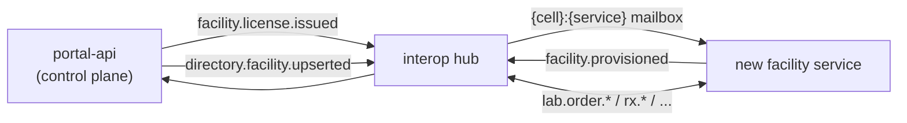

# Platform contract for facility-type services

This is what a new facility-type service (imaging, dental, ...) has to implement to join the ClinicEZ platform. It is written from the code as it stands today. Where the code and the target architecture ([hub README](../../services/interop-hub/README.md), architecture plan) differ, the difference is called out as **Gap**.

Related docs: [interop-hub.md](interop-hub.md) · [data-ownership.md](data-ownership.md) · [billing.md](billing.md)

A facility service is one deployable that is the **system of record for its own operational data** and keeps working without the cloud. It has five obligations:

| # | Obligation | One line |
|---|---|---|
| 1 | [Provisioning from license](#1-provisioning-from-license) | Activate on `facility.license.issued`, verify the signed license, honour its limits and features. |
| 2 | [Local auth](#2-local-auth) | Facility-local JWT with `tenant_id` + a facility claim; no identity provider, no internet. |
| 3 | [Envelope handlers](#3-envelope-handlers-and-the-outboxinbox) | `IInteropHandler<T>`, transactional outbox/inbox through `AddInterop<TDbContext>`, idempotent. |
| 4 | [Directory registration](#4-directory-registration) | The portal registers the facility; the service does nothing but be routable. |
| 5 | [Entitlement keys](#5-entitlement-keys) | Limits and features come from the signed license. |



---

## 1. Provisioning from license

**Flow.** The portal creates the facility, signs a license (ECDSA, bound to `FacilityId` + `TenantId`) and stages `facility.license.issued` in its outbox in the same `SaveChanges` as the facility row ([FacilityProvisioningPublisher](../../services/portal-api/ClinicEz.Portal.Application/Features/Admin/Services/FacilityProvisioningPublisher.cs)). The message is addressed to `Party.ForFacility(tenantId, facilityId, facilityType)` and carries a [`FacilityCreatedEvent`](../../packages/shared-dotnet/Common/FacilityCreatedEvent.cs) (license token, limits, plan tier, expiry, console URL). A second, license-free copy goes to patient-api as `facility.directory.updated`.

**What the service handler must do** (reference: clinic [FacilityCreatedHandler](../../services/clinic-api/ClinicEz.Clinic.Infrastructure/Messaging/Handlers/FacilityCreatedHandler.cs), lab [FacilityLicenseIssuedHandler](../../services/laboratory-api/ClinicEz.Laboratory.Application/Interop/FacilityLicenseIssuedHandler.cs)):

1. Ignore the message unless `message.FacilityType` is your type (the same handler type is registered by clinic, lab, pharmacy and organization, so each filters).
2. Accept it only from the control plane: `context.From.Kind == PartyKind.ControlPlane`.
3. Accept it only when addressed to *this* facility: `To.Kind == Facility`, `To.FacilityId == message.ResourceId`, `To.TenantId == message.TenantId`.
4. Upsert the local settings row (license token, plan tier, limits, expiry, names). Provisioning is an upsert, so redelivery changes nothing.
5. Enqueue `facility.provisioned` (`FacilityProvisionedEvent`, `To = Party.Portal`, `CorrelationId = context.CorrelationId`) **before** the `SaveChanges` that persists the settings. The portal marks the facility provisioned when it arrives.

**License verification.** Register `IFacilityLicenseValidator` as a singleton ([FacilityLicenseValidator](../../packages/shared-dotnet/Licensing/FacilityLicenseValidator.cs)). `Validate(token, expectedFacilityId, expectedTenantId)` checks, in order: format `payload.signature` (Base64Url), ECDSA-P256/SHA-256 signature against the authority public key (`FacilityLicense:PublicKeyPem` config, else `FACILITY_LICENSE_PUBLIC_KEY`, else the compiled-in default), facility binding, tenant binding (id or slug), expiry. Results: `Success`, `Expired` (payload still returned; the validator message says "Grace Read-Only mode"), `Tampered`, `Missing`.

| Item | Today |
|---|---|
| License payload | [`FacilityLicensePayload`](../../packages/shared-dotnet/Licensing/FacilityLicensePayload.cs): `LicenseId`, `FacilityId`, `TenantId`, `TenantSlug`, `FacilityName`, `FacilityType` (string), `OwnerEmail/Name`, `PlanTier`, `Limits`, `EnabledFeatures`, `IssuedAtUtc`, `ExpiresAtUtc`, `Issuer`. |
| Offline | Verification needs only the public key. A service must not call the cloud to validate. |
| Expiry | Staff creation/activation is refused when expired (clinic [CreateStaffMemberCommand](../../services/clinic-api/ClinicEz.Clinic.Application/Features/Staff/Commands/CreateStaffMemberCommand.cs)); reported as `Expired` by the license endpoints. **Gap:** the planned workspace-status field, entitlement version, renewal heartbeat and N-day read-only grace are not in the payload or the code. |
| Revocation | There is no revocation list. A suspended facility is removed from the hub directory (it stops receiving messages) but its already-issued license keeps validating offline until it expires. |

---

## 2. Local auth

Shared library: [`AddFacilityLocalAuth(configuration, audience)`](../../packages/shared-dotnet/LocalAuth/FacilityLocalAuthExtensions.cs).

- HMAC-SHA256 JWT bearer validated locally (issuer/audience/lifetime/signing key), no identity provider. Pick a **distinct `audience` per service** so a token from one service is rejected by another.
- A second scheme (`Internal`, service key) for trusted service-to-service calls, and a **fallback policy that requires an authenticated user**: only `[AllowAnonymous]` endpoints are public.
- Token claims, as the existing services define them (`*ClaimTypes.cs`):

| Claim | clinic | laboratory | pharmacy |
|---|---|---|---|
| tenant | `tenant_id` | `tenant_id` | `tenant_id` |
| facility | `clinic_id` | `laboratory_id` | `pharmacy_id` |
| other | `sub`, `branch_id`, `permission`, `ver`, `role_id`, `staff_role`, `name` | `sub`, `permission`, `ver`, `staff_role`, `name` | `sub`, `permission`, `ver`, `staff_role`, `name` |

  **Gap:** the plan standardises on `tenant_id` + `facility_id` and `X-Facility-Id`/`X-Tenant-Id` everywhere. Today the tenant claim is uniform but the facility claim is per service (`clinic_id`, `laboratory_id`, `pharmacy_id`). A new service should follow the existing pattern (`tenant_id` + `<type>_id`) until the claim is unified.
- **Headers are hints, never authority.** For an authenticated staff token, tenant and facility come only from the claims. `X-Facility-Id`, if sent, must equal the token's facility or the request gets `403` ([LabScopeMiddleware](../../services/laboratory-api/ClinicEz.Laboratory.Infrastructure/Auth/LabScopeMiddleware.cs)). `X-Tenant-Id` is honoured only for the `Internal` scheme and for anonymous workspace resolution ([LabContext](../../services/laboratory-api/ClinicEz.Laboratory.Infrastructure/Context/LabContext.cs)).
- **No HTTP context = system scope** (interop handlers, Hangfire). Handlers therefore have to scope by the envelope explicitly (see below); EF query filters do not protect them.
- License-derived: the facility id, tenant and limits the service trusts are the ones in the validated license, not what a caller sends. Bootstrap of the first administrator can use the signed `OwnerEmail`/`OwnerName`.

---

## 3. Envelope handlers and the outbox/inbox

All cross-service and cross-facility traffic is an [`InteropEnvelope`](../../packages/shared-dotnet/Interop/InteropEnvelope.cs) relayed by the hub. There is no broker and no direct HTTP between services (see [interop-hub.md](interop-hub.md)).

### Wire up

```csharp
// Infrastructure/DependencyInjection.cs
services.AddInterop<ApplicationDbContext>(configuration, handlers => handlers
    .Handle<FacilityCreatedEvent, FacilityLicenseIssuedHandler>(InteropTypes.FacilityLicenseIssued)
    .Handle<LabRequisitionIssuedEvent, LabOrderIssuedHandler>(InteropTypes.LabOrderIssued));

// Persistence/ApplicationDbContext.cs
public class ApplicationDbContext : DbContext, IInteropDbContext
{
    public DbSet<InteropOutboxMessage> InteropOutbox => Set<InteropOutboxMessage>();
    public DbSet<InteropInboxMessage>  InteropInbox  => Set<InteropInboxMessage>();
    protected override void OnModelCreating(ModelBuilder b) { /* ... */ b.ApplyInteropModel(); }
}
```

`AddInterop` ([source](../../packages/shared-dotnet/Interop/InteropServiceCollectionExtensions.cs)) binds and validates the `Messaging` section at host start, registers the handler registry, `IInteropPublisher`, `InteropDispatcher`, the hub client, and two hosted services: the **relay** (outbox to hub) and the **inbox poller** (hub mailbox to handlers). Add an EF migration for the `interop_outbox` and `interop_inbox` tables.

### `Messaging` configuration

Bound from section `Messaging` ([InteropOptions](../../packages/shared-dotnet/Interop/InteropOptions.cs)). There are **no default credentials**; start-up fails if a required value is missing.

| Key | Env var form | Default | Notes |
|---|---|---|---|
| `Messaging:Transport` | `Messaging__Transport` | `Hub` | `Hub` or `InProcess` (tests only). |
| `Messaging:HubUrl` | `Messaging__HubUrl` | none | The cell's hub: the cloud hub, or the edge cell's local hub. |
| `Messaging:ClientId` | `Messaging__ClientId` | none | Hub client of this service. |
| `Messaging:ClientSecret` | `Messaging__ClientSecret` | none | Shown once at creation; rotate through the portal. |
| `Messaging:Service` | `Messaging__Service` | none | Mailbox this service reads (`clinic`, `laboratory`, ...). Must equal the hub client's service. |
| `Messaging:Enabled` | `Messaging__Enabled` | `true` | `false` registers the SDK without relay/poller (tests, migrations). |
| `RelayIntervalMs`, `PollWaitSeconds`, `BatchSize` | `Messaging__...` | 1000, 20, 50 | Relay idle delay, long-poll wait, batch. |
| `OutboxRetentionDays`, `InboxRetentionDays` | `Messaging__...` | 7, 14 | Shipped outbox rows / processed inbox rows are purged after this. |

Deploy compose files map `MESSAGING_HUB_URL`, `MESSAGING_CLIENT_ID`, `MESSAGING_CLIENT_SECRET` to these (see [deploy/clinic-api/docker-compose.yml](../../deploy/clinic-api/docker-compose.yml)); `Messaging__Transport=Hub` and `Messaging__Service=<service>` are fixed in the compose file.

### Rules every handler and publisher follows

1. **Publish before `SaveChanges`.** `IInteropPublisher.Enqueue(...)` only adds an `interop_outbox` row to the `DbContext`; it is committed by the *same* `SaveChanges` as the business change, so the message exists if and only if the change committed. Never enqueue after saving and never fire-and-forget ([InteropPublisher](../../packages/shared-dotnet/Interop/InteropPublisher.cs)). `Enqueue` also fails fast (inside your transaction) if the target service cannot be resolved.
2. **Handlers are idempotent.** Delivery is at-least-once. The dispatcher skips message ids already in `interop_inbox`, but the inbox row is written *after* the handler runs, so a crash in between causes exactly one more run. A handler's own `SaveChanges` is its commit point ([InteropDispatcher](../../packages/shared-dotnet/Interop/Handling/InteropDispatcher.cs)).
3. **Authorize the envelope.** The hub guarantees `From` belongs to the sending client, but each handler must still check that the sender may send *this* type (e.g. only `PartyKind.ControlPlane` for provisioning) and that `To` is the facility it is running as. Never trust ids inside the payload over `From`/`To`.
4. **Scope by the envelope.** There is no HTTP context in a handler, so tenant/facility query filters are bypassed. Resolve tenant and facility from `context.To` and filter explicitly. Match on globally unique ids (`RequisitionId`, `PrescriptionId`), never per-clinic counters.
5. **Return semantics.** Returning normally acks. Throwing nacks: the hub redelivers (delay `NackDelaySeconds` x attempt, max 5 min) and dead-letters after `MaxDeliveryAttempts` (10). Drop (log and return) anything that can never succeed. A type with **no registered handler** is also not acked: it will be redelivered and eventually dead-lettered, so do not receive types you do not handle.
6. **Replies reuse the correlation id** (`context.CorrelationId`) so the hub's reply rule and per-workflow ordering apply. The relay ships outbox rows oldest-first and retries forever with exponential backoff (cap 5 min); only a hub `rejected` verdict dead-letters a row locally.
7. **Addressing.** `Party.ForFacility(tenantId, facilityId, type, service?)` for facilities, `Party.ForPatient(id)` for patients, `Party.Portal` for the control plane. `To.Service` selects another service mailbox in the target's cell (for example `billing`); otherwise the facility type's default mailbox is used.

Tests use `Messaging:Transport=InProcess` with the in-process hub ([InProcessHub](../../packages/shared-dotnet/Interop/Transport/InProcessHub.cs)); see the pharmacy [PharmacyInteropHandlerTests](../../services/pharmacy-api/ClinicEz.Pharmacy.Application.Tests/PharmacyInteropHandlerTests.cs) for the pattern.

---

## 4. Directory registration

A facility service does **not** register itself. The portal is the directory authority:

1. Any `SaveChanges` that creates, renames, activates, suspends, deletes or moves a facility, or changes its visibility or hosting, makes [FacilityDirectoryInterceptor](../../services/portal-api/ClinicEz.Portal.Infrastructure/Persistence/Interceptors/FacilityDirectoryInterceptor.cs) stage `directory.cell.upserted` (when the cell is new/changed), `directory.facility.upserted` and, for same-branch facilities, `directory.link.upserted`, in the same transaction. They are stamped to ship before the facility's own `facility.license.issued`, so the facility is routable when its license arrives ([DirectoryFeedWriter](../../services/portal-api/ClinicEz.Portal.Infrastructure/Hub/DirectoryFeedWriter.cs)). `POST /api/v1/admin/hub/resync` re-sends everything.
2. The directory row is [`DirectoryFacilityUpsertedPayload`](../../packages/shared-dotnet/Interop/Contracts/DirectoryContracts.cs): `TenantId`, `FacilityId`, `FacilityType`, `CellId`, `DisplayName`, `BranchId`, `City`, `Visibility`, `AcceptsExternalRequests`, `Active`. `Active` is true while the facility is `Provisioning` or `Active` and not deleted (a provisioning facility must already be routable).
3. **Visibility** (`Private` default, `Network`, `Public`) decides who can see it in `GET /v1/directory/facilities` and whether a cross-tenant link may target it. **Gap:** the portal has no endpoint that sets `Visibility`/`AcceptsExternalRequests` today (they default to `Private`/`false`), and the only links the portal creates are automatic same-tenant same-branch links; cross-tenant link request/approval is not implemented in the portal (the hub already enforces links when they exist).
4. **How a new service appears to the platform:**
   - The directory entry is found by `(TenantId, FacilityId)`; the **mailbox** is `{cellId}:{service}` where `service` is `To.Service` or the default for the facility type (`InteropServices.ForFacilityType`). In an edge cell the cloud routes to `{cell}:cell-inbox` and the local hub fans out by service.
   - A **hub client** must exist for the service in its cell, with `Service` = the mailbox name. For on-prem, the portal creates the `EdgeCell` client when the facility is created and returns `HubEdgeCredentials` (hub URL, client id, secret, shown once) ([HubOnboardingService](../../services/portal-api/ClinicEz.Portal.Application/Features/Hub/HubOnboardingService.cs)). For the shared cloud cell, **operations provision the client** (bootstrap config or the hub admin API) and put the credentials in the service's `Messaging:*`.

---

## 5. Entitlement keys

What exists today is carried **inside the signed license** and enforced offline by the facility:

- **Limits** ([`FacilityLimits`](../../packages/shared-dotnet/Licensing/FacilityLimits.cs)): `maxStaff`, `maxBeds`, `maxAnalyzers`, `maxMonthlyConsultations`, `maxStorageMb`, `concurrentTerminals`.
- **Features** (`EnabledFeatures`, keys in [`FacilityFeatureKeys`](../../packages/shared-dotnet/Licensing/FacilityFeatureKeys.cs)): `Teleconsultation`, `ElectronicPrescriptions`, `LisIntegration`, `InventoryManagement`, `PhilHealthKonsulta`, `MultiTerminalSync`, `AdvancedAnalytics`, `CustomLetterhead`.
- Tier defaults (`Community`, `Standard`, `Enterprise`) in [`PlanTierDefaults`](../../packages/shared-dotnet/Licensing/PlanTierDefaults.cs).

A new type adds its own limit property and feature key constants there and checks them from the validated license payload (never from the request).

**Gap:** the plan's dotted keys (`limit.facilities.*`, `limit.branches`, `feature.cross_tenant_interop`, ...), the per-workspace entitlement snapshot, and the `entitlements.changed` re-mint flow are **not implemented**: the type exists in `InteropTypes` but has no payload record, producer or handler. Portal-side enforcement today is the clinic-count check in [TenantFeatureGuard](../../services/portal-api/ClinicEz.Portal.Infrastructure/Services/TenantFeatureGuard.cs).

---

## Making `FacilityType` extensible

[`FacilityType`](../../packages/shared-dotnet/Common/FacilityType.cs) is a closed enum (`Clinic`, `Organization`, `Laboratory`, `Pharmacy`) serialised as a **string** on the wire (`JsonStringEnumConverter`) and stored as a string in the portal (`HasConversion<string>()`) and in the hub (`HasConversion<string>().HasMaxLength(24)`). Adding a value is a source change, a coordinated deploy, and a handful of switches. Precisely:

| # | What must change | Where | Why / failure if skipped |
|---|---|---|---|
| 1 | Add the enum value (append at the end; keep the name <= 24 characters) | [FacilityType.cs](../../packages/shared-dotnet/Common/FacilityType.cs) | Hub column is `varchar(24)`. |
| 2 | Add a service-name constant and a `ForFacilityType` case | [Party.cs](../../packages/shared-dotnet/Interop/Party.cs) (`InteropServices`) | `ForFacilityType` has a throwing default arm: `Party.ForFacility(...)`/`InteropServices.For` throw `ArgumentOutOfRangeException`. `IInteropPublisher.Enqueue` calls it, so portal's `EnqueueLicenseIssued` (and therefore facility creation) fails; `HubOnboardingService` fails the same way. The hub itself no longer throws: `RoutingPolicy.ServiceFor` routes by `To.Service` or rejects with `unknown_facility_type`. |
| 3 | Make sure the service name passes `MailboxNames.IsValidService`: starts with `a-z`, then `a-z`, `0-9`, `-`; 1 to 32 characters; not `cell-inbox`, not `hub` | [HubContracts.cs](../../services/interop-hub/ClinicEz.Interop.Application/HubContracts.cs) | Hub refuses to create a client or route to an invalid service name. `billing`, `patient`, `portal` are additional well-known services, not facility types. |
| 4 | Deploy the **hub first**, then portal, then services | hub, portal | Hub, portal and services share the enum via `ClinicEz.Shared`. An older hub fails to deserialise `directory.facility.upserted` with an unknown `FacilityType`. |
| 5 | Portal: type-specific switches (default subdomain in `GetFacilitiesQuery`, `ProcessTenantWorkspaceWebhookCommand`, any plan/limit rule in `TenantFeatureGuard`) and the portal-web facility type lists/labels | `services/portal-api/**`, `apps/portal-web/**` | `grep -rn "FacilityType\." services apps` finds the rest. |
| 6 | License: `FacilityLicensePayload.FacilityType` is a free string; extend `FacilityLimits`/`FacilityFeatureKeys`/`PlanTierDefaults` if the type needs its own limits or features | [Licensing](../../packages/shared-dotnet/Licensing) | See [section 5](#5-entitlement-keys). |
| 7 | Directory: no schema change; the type is just a string column and a query filter (`?type=`) | hub | Directory search and claims (`To.FacilityType`) work for any value. |
| 8 | Link scopes: add a `LinkScopes` flag and a `MessageScopes.For(type)` prefix rule if the new type has its own cross-tenant message kinds | [DirectoryContracts.cs](../../packages/shared-dotnet/Interop/Contracts/DirectoryContracts.cs), [HubContracts.cs](../../services/interop-hub/ClinicEz.Interop.Application/HubContracts.cs) | Without a scope mapping the new message types cross tenants only as replies. |
| 9 | Tests | hub `CrossTenantTests` (`IsValidService` theory), a handler test with `InProcess` transport, a portal test that creating the facility stages `facility.license.issued` and the directory upsert | |

`FacilityType` could later become an open string (registry-driven) to avoid steps 1, 2 and 4; that is a larger change touching every switch and is not planned in code today.

---

## Add a new service: checklist

1. **Scaffold** `services/<name>-api` with the Clean Architecture projects used by clinic/lab/pharmacy (`.Api`, `.Application`, `.Domain`, `.Infrastructure`, tests) and a Dockerfile.
2. **Extend `FacilityType`** and the related switches (table above), including `InteropServices.<Name>` and the `ForFacilityType` case.
3. **Persistence:** your `ApplicationDbContext : IInteropDbContext`, `ApplyInteropModel()`, and a migration with `interop_outbox` / `interop_inbox`. Per-facility settings table holding the license token, limits and expiry.
4. **Auth:** `AddFacilityLocalAuth(configuration, "<name>-api")`, claims `tenant_id` + `<name>_id`, a scope middleware that rejects a mismatching `X-Facility-Id`, a context class that takes tenant/facility only from claims, no anonymous endpoints except the public ones you explicitly mark.
5. **Provisioning handler:** `FacilityLicenseIssued` handler with the four checks and the `facility.provisioned` ack (copy the lab handler); register `IFacilityLicenseValidator`; license/status endpoints like the existing `LicenseController`s.
6. **Domain handlers/publishers** for your message types: add constants to [`InteropTypes`](../../packages/shared-dotnet/Interop/InteropTypes.cs) (the only place), payload records under `packages/shared-dotnet/Interoperability`, register with `.Handle<TPayload, THandler>(type)`; publish before `SaveChanges`.
7. **Messaging config:** `Messaging__Transport/Service/HubUrl/ClientId/ClientSecret` in `deploy/<name>-api/docker-compose.yml` and the deploy workflow secrets (`<NAME>_MESSAGING_CLIENT_ID/SECRET`), mirroring [deploy-laboratory-api-dev.yml](../../.github/workflows/deploy-laboratory-api-dev.yml).
8. **Hub client:** cloud cell: operations create a `CloudService` client with `Service=<name>` in cell `cloud`; on-prem: the portal creates the `EdgeCell` client automatically when it creates the facility (check `HubOnboardingService.CreateClientAsync` resolves your service name).
9. **Billing integration (optional):** send `billing.invoice.requested` with `To.Service = "billing"` and wait for `billing.payment.confirmed` (see [billing.md](billing.md); the billing service is still a work in progress).
10. **Tests:** handler tests on the `InProcess` transport, a cross-tenant isolation test (two tenants, same external id), license validator tests, and the portal-side test that creating the facility stages the license and directory messages.
11. **Docs and guard:** list the new types in the [message matrix](message-matrix.md); `scripts/check-no-broker.ps1` (run from `backend-ci.yml`) keeps broker or MassTransit references out of the repo.

---

## Message type catalog

Every `InteropTypes` constant, with its sender, receiver, payload record, addressing and correlation, and the gaps where a message is sent but nobody handles it, is in [`message-matrix.md`](message-matrix.md). It replaces the catalog that used to live here, which went stale as producers and handlers landed.

- `InteropTypes.IsHubInternal(type)` is true for the `directory.*` family; the hub applies those itself.
- Payload records live in two folders: `Common/` (older events, some still named `...Event`) and `Interoperability/` (newer contracts). They are plain JSON records serialised with `InteropJson` (camelCase, string enums, nulls omitted).
- Envelope `SchemaVersion` defaults to 1 and nothing branches on it yet; add a new type or bump it deliberately when a payload breaks.
