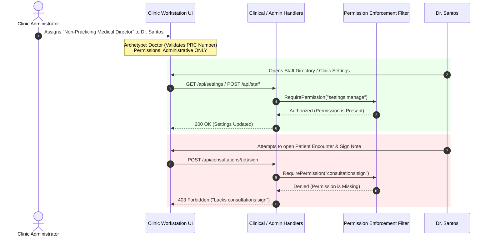

# Role-Based Access Control (RBAC) & Archetypes

## 1. Architectural Overview

ClinicEZ separates **Statutory Clinical Identity** from **Application Permissions** using an **Archetype-Constrained Hierarchical RBAC** model.

```
                          ┌─────────────────────────────┐
                          │         Clinic Role         │
                          │ "Non-Practicing Med Director"│
                          └──────────────┬──────────────┘
                                         │
                 ┌───────────────────────┴───────────────────────┐
                 ▼                                               ▼
     ┌───────────────────────┐                       ┌───────────────────────┐
     │  Statutory Archetype  │                       │  Granular Permissions │
     │       "Doctor"        │                       │   [settings:manage,   │
     │  (PRC, PTR, S2 bound) │                       │     staff:manage]     │
     └───────────────────────┘                       └───────────────────────┘
```

1. **Statutory Archetype (`StaffRole`)**:
   - Fixed domain classification (`Doctor`, `Nurse`, `Receptionist`, `Cashier`, `Admin`).
   - Governs mandatory licensing validations (PRC License Number, PTR, PDEA S2 narcotics license), room stationing eligibility, and sole-admin lockout prevention.
   - Defines the **permission ceiling** (the maximum allowable set of capabilities).
2. **Granular Permissions (`ClinicPermissions`)**:
   - Specific operational privileges toggled ON or OFF for each custom role.
   - The permissions granted cannot exceed the archetype's statutory ceiling.

---

## 2. Archetype Capability & Permission Ceilings Matrix

The archetype establishes what permissions can legally be enabled. An administrator can restrict or toggle off any permission within that ceiling.

| Archetype | Statutory Validation | Room Stationing | Clinical Signing<br>(`consultations:sign`) | Triage & Procedures<br>(`triage:write`, `procedures:write`) | Front Desk Operations<br>(`appointments:*`, `queue:*`) | Billing & Cashier<br>(`billing:*`) | Facility Administration<br>(`settings:manage`, `staff:manage`) |
| :--- | :--- | :--- | :---: | :---: | :---: | :---: | :---: |
| **Doctor** | **PRC License #** (Mandatory), PTR, S2 | Yes *(Consultation Room)* | ✅ **Allowed** *(Can be enabled/disabled)* | ✅ Allowed | ✅ Allowed | ✅ Allowed | ✅ Allowed |
| **Nurse** | Nursing Licensure | Yes *(Triage Room)* | 🚫 **FORBIDDEN** | ✅ **Allowed** *(Can be enabled/disabled)* | ✅ Allowed | ✅ Allowed | ✅ Allowed |
| **Admin** | None *(Operational)* | No | 🚫 **FORBIDDEN** | 🚫 **FORBIDDEN** | ✅ Allowed | ✅ Allowed | ✅ **Allowed** |
| **Receptionist** | None *(Front Desk)* | No | 🚫 **FORBIDDEN** | 🚫 **FORBIDDEN** | ✅ **Allowed** | Optional | 🚫 Forbidden |
| **Cashier** | None *(Billing)* | No | 🚫 **FORBIDDEN** | 🚫 **FORBIDDEN** | Optional | ✅ **Allowed** | 🚫 Forbidden |

---

## 3. Configured Mapping: Doctor Archetype with Administrative Rights & Restricted Clinical Operations

This configuration models an **Administrative Medical Director**, **Non-Practicing Chief Medical Officer (CMO)**, or **Clinic Executive** who is a licensed physician for accreditation purposes, but whose duties are strictly managerial and excluded from direct patient charting.

### Configuration Specification

- **Role Name**: `Non-Practicing Medical Director` (or `Clinical Operations Director`)
- **Statutory Archetype**: `Doctor`
- **Mandatory Requirements Enforced**:
  - Valid **PRC License Number** must be provided upon account creation.
  - Satisfies the facility directory publishing readiness check (`PublishClinicToDirectoryCommand`).

### Detailed Permission Mapping

#### A. Administrative Permissions Granted (Enabled)
| Permission Constant | Value | Description & Purpose |
| :--- | :--- | :--- |
| `ClinicPermissions.SettingsRead` | `settings:read` | View facility configuration and profile. |
| `ClinicPermissions.SettingsManage` | `settings:manage` | Update clinic operating hours, letterhead, and branding. |
| `ClinicPermissions.StaffRead` | `staff:read` | View full clinic staff directory and roster. |
| `ClinicPermissions.StaffManage` | `staff:manage` | Invite, provision, edit, and deactivate clinic staff accounts. |
| `ClinicPermissions.RolesRead` | `roles:read` | Inspect clinic custom roles and permission maps. |
| `ClinicPermissions.RolesManage` | `roles:manage` | Author and update clinic-scoped RBAC roles. |
| `ClinicPermissions.ServicesRead` | `services:read` | View procedure catalog and fee schedules. |
| `ClinicPermissions.ServicesManage` | `services:manage` | Update procedure catalog, prices, and PhilHealth items. |
| `ClinicPermissions.ReportsRead` | `reports:read` | View daily collections, census, and analytics reports. |
| `ClinicPermissions.AuditRead` | `audit:read` | Inspect audit trail forensics and security events. |
| `ClinicPermissions.AuditExport` | `audit:export` | Export compliance and access logs for regulatory review. |

#### B. Clinical Operations Restricted (Disabled / Stripped)
| Permission Constant | Value | Enforcement Effect |
| :--- | :--- | :--- |
| `ClinicPermissions.ConsultationsWrite` | `consultations:write` | **Disabled**: Cannot create or modify patient SOAP encounter notes. |
| `ClinicPermissions.ConsultationsSign` | `consultations:sign` | **Disabled**: Cannot sign or stamp clinical consultation records. |
| `ClinicPermissions.DocumentsIssue` | `documents:issue` | **Disabled**: Cannot issue official medical certificates or referral letters. |
| `ClinicPermissions.LabOrdersWrite` | `laborders:write` | **Disabled**: Cannot order clinical laboratory tests. |
| `ClinicPermissions.LabResultsReview` | `labresults:review` | **Disabled**: Cannot sign off or approve diagnostic lab results. |
| `ClinicPermissions.ProceduresWrite` | `procedures:write` | **Disabled**: Cannot execute or document clinical procedures. |
| `ClinicPermissions.TriageWrite` | `triage:write` | **Disabled**: Cannot record triage vital signs. |

---

## 4. Operational Lifecycle & Enforcement Flow



### Key Safety Guarantees
1. **Accreditation Preserved**: The clinic meets government accreditation criteria because an active physician with a valid PRC license is enrolled.
2. **Clinical Malpractice Prevention**: Because clinical charting and signing permissions are omitted, this user cannot inadvertently or maliciously sign off on patient medical charts without clinical authorization.
3. **Fail-Safe Administration**: The user can safely govern facility configurations, manage staff, and audit records without conflicting with practicing attending physicians.
